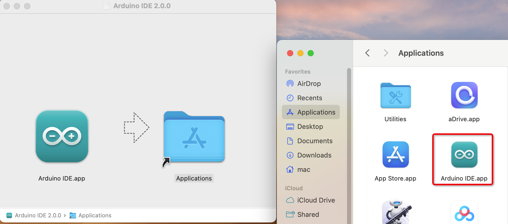
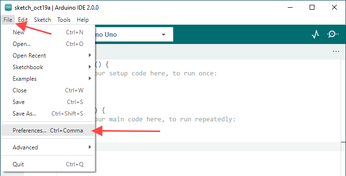
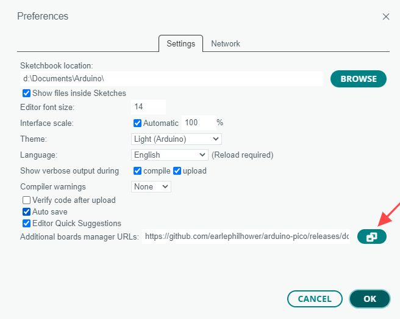
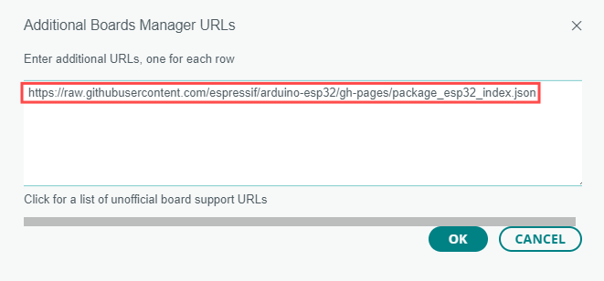
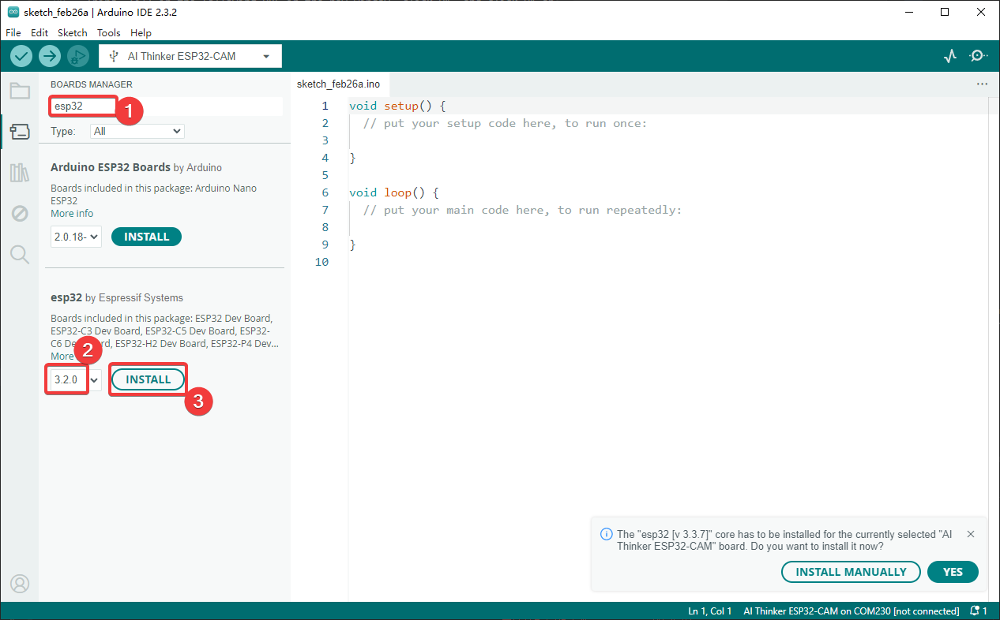
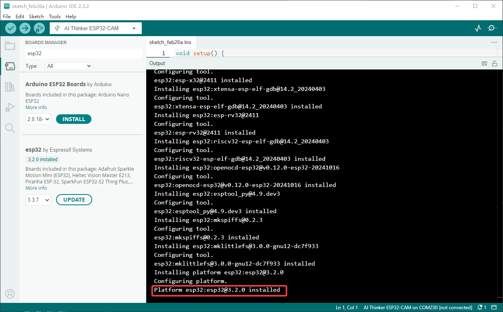
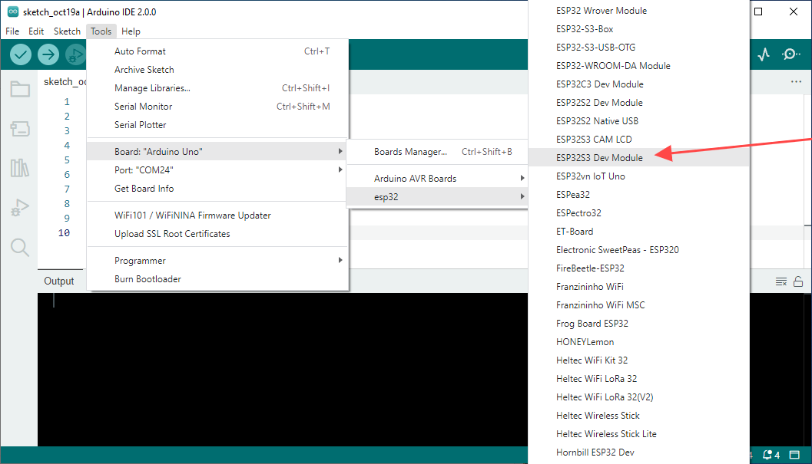

.. _install_arduino_ide:

Install Arduino IDE
=======================

Download the Arduino IDE
-------------------------------

#. Visit the `Download Arduino IDE <https://www.arduino.cc/en/software>`_ page.

#. Download the IDE for your operating system. This guide references version 2.3.10; the screenshot shows version 2.3.2.

   .. image:: img/Install_Arduino_IDE_1.png

.. note::
   This tutorial uses Arduino IDE 2.x. After installation, follow :ref:`arduino-board-settings` to configure the board.

Installation
--------------

Windows
^^^^^^^^

#. Double-click the downloaded ``arduino-ide_xxxx.exe`` file to run the installer.

#. Read and accept the License Agreement.

   .. image:: img/Install_Arduino_IDE_2.png

#. Choose installation options.

   .. image:: img/Install_Arduino_IDE_3.png

#. Choose an installation location. A drive other than the system drive is recommended.

   .. image:: img/Install_Arduino_IDE_4.png

#. Complete the installation and click Finish.

   .. image:: img/Install_Arduino_IDE_5.png

macOS
^^^^^^^^

Double-click the downloaded ``arduino_ide_xxxx.dmg`` file and follow the
instructions to copy **Arduino IDE.app** to the **Applications** folder. Installation should finish after a few seconds.

Linux
^^^^^^^^

For instructions on installing Arduino IDE 2.0 on Linux,
see `Linux-Install Arduino IDE <https://docs.arduino.cc/software/ide-v2/tutorials/getting-started/ide-v2-downloading-and-installing#linux>`_.

Open the IDE
--------------

#. When you first open Arduino IDE 2.0, it automatically installs the Arduino AVR Boards, built-in libraries, and other required files.

   .. image:: img/Install_Arduino_IDE_7.png

#. Your firewall or security software may show several prompts to install device drivers. Approve the driver installations.

   .. image:: img/Install_Arduino_IDE_8.png

#. Arduino IDE is now ready to use.

.. note::
   If some components fail to install because of network issues or other reasons,
   reopen Arduino IDE to finish the installation.
   Once installation is complete, the Output window does not open automatically;
   click Verify or Upload to open it.

.. _install_esp32_board_package:

Install the ESP32 Board Package
-------------------------------

Open Arduino IDE and select **File → Preferences**.

Click the icon next to **Additional Boards Manager URLs**.

Enter the following URL in the new window and click **OK**, then click **OK** again in Preferences.

   ``https://espressif.github.io/arduino-esp32/package_esp32_index.json``

Open **Boards Manager**, search for ``esp32``, select version **3.2.0**,
and click **INSTALL**.

Arduino IDE downloads the required files automatically. Wait for installation to finish.

After installation, open **Tools → Board** and select **ESP32S3 Dev Module**
from the ESP32 board list. The ESP32-S3 development environment is now configured.

