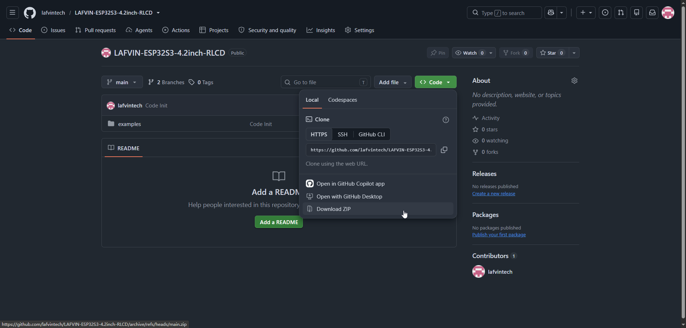

.. _download-code:

Download the Example Code
=========================

Before opening an example, download the product's code package. It should include the Arduino examples, ESP-IDF examples, and any local libraries required by the LAFVIN ESP32-S3 4.2inch RLCD Development Board.

* `Download Source Code (ZIP) <https://github.com/lafvintech/LAFVIN-ESP32S3-4.2inch-RLCD/archive/refs/heads/main.zip>`_

After downloading and extracting the package to your computer, you should see the following files:

