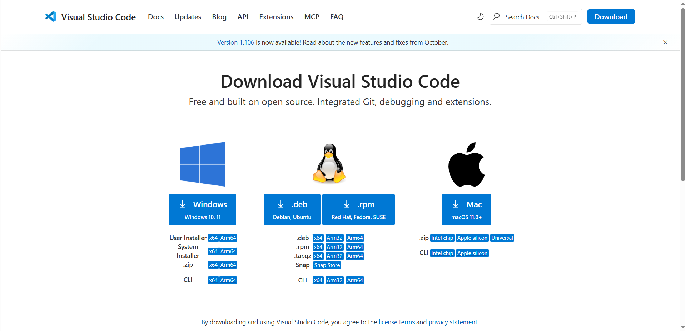
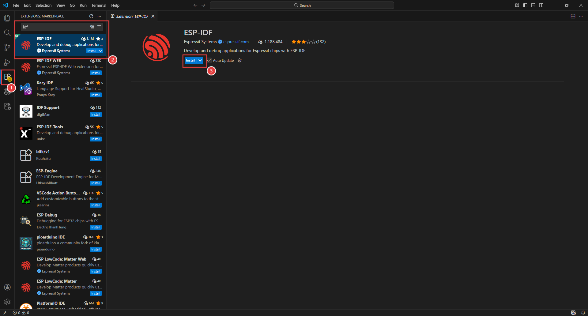
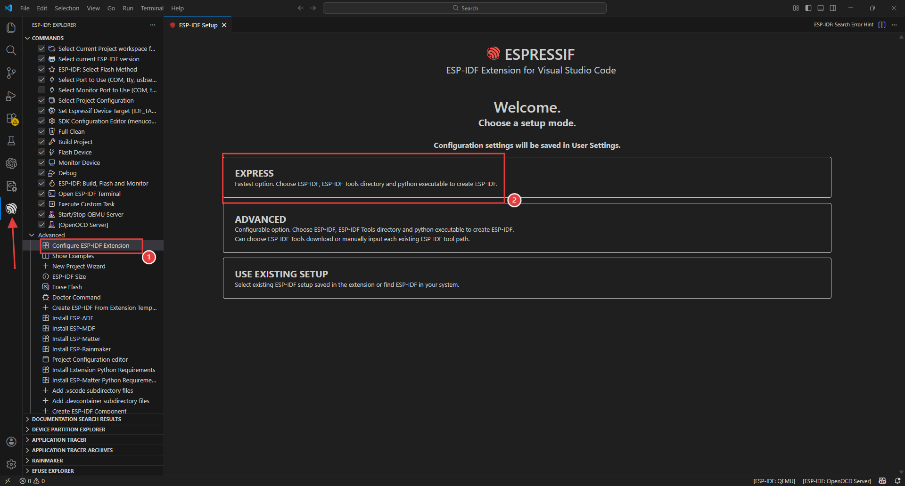
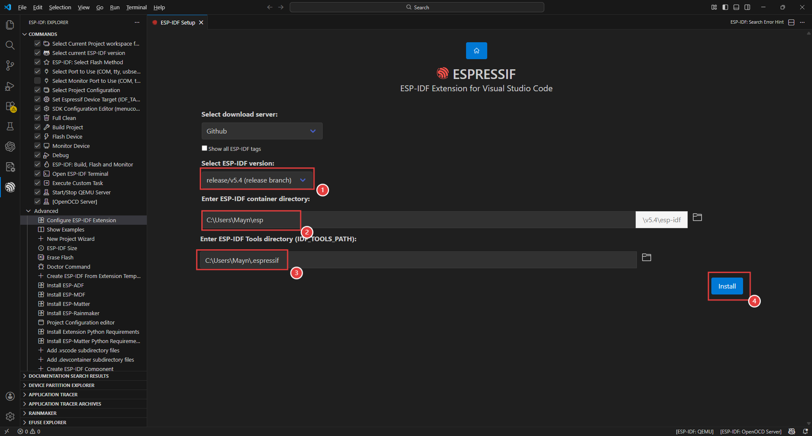
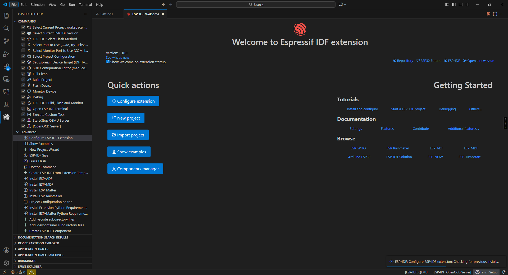
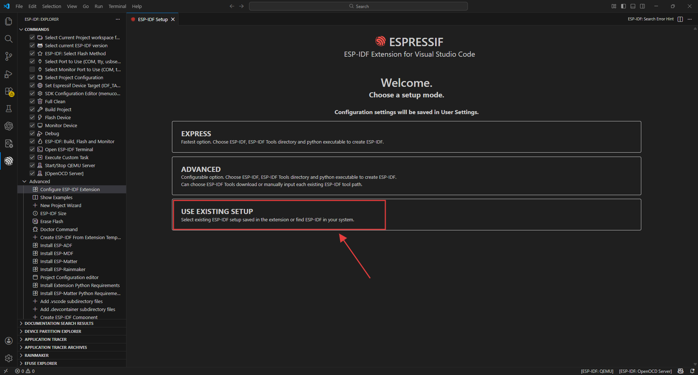
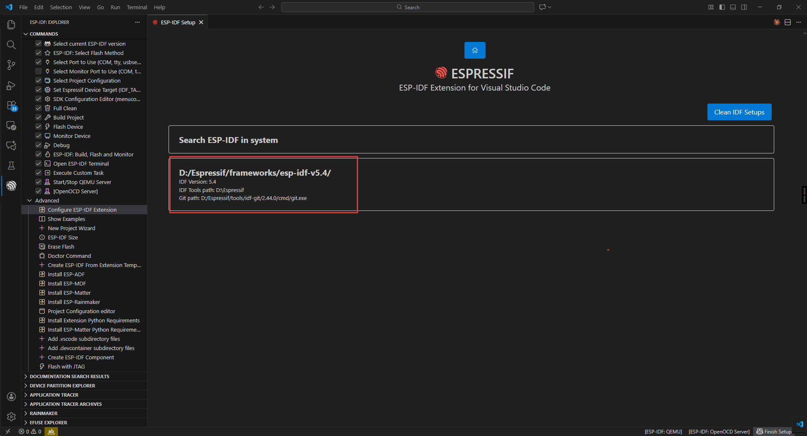

.. _idf_install:

ESP-IDF Development Environment Setup
=========================================

Install VS Code and the ESP-IDF Extension
-----------------------------------------

Open the `VS Code download page <https://code.visualstudio.com/download>`_ and download the installer for your operating system and architecture.

Run the installer. After installation, open VS Code, search for ``esp-idf`` in the Extensions panel on the left, and install the ESP-IDF extension.

Click the IDF extension icon on the left, open **Advanced**, select **Configure ESP-IDF extension**, and click **EXPRESS**.

Select a download server and ESP-IDF version (**5.4** in this guide), then click **Install**.
Wait while the extension downloads and installs the required tools and environment.

The following screen confirms that installation is complete.

If you already have an offline ESP-IDF installation, import it into the extension without downloading it again.

