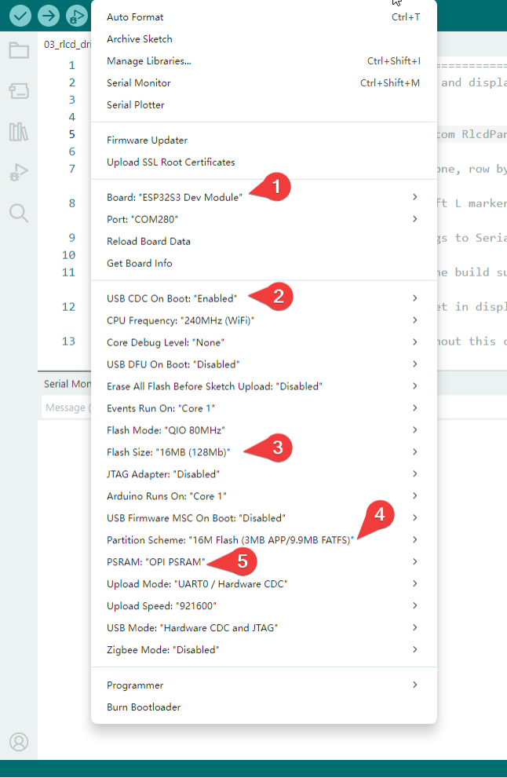

.. _arduino-tutorial:

1. Arduino
==========

This section uses Arduino IDE to write and upload programs for the
LAFVIN ESP32-S3 4.2inch RLCD Development Board. Start by reading battery voltage through the serial port,
then learn about Wi-Fi, the reflective LCD, the clock, temperature and humidity, storage, and audio.
Later examples combine these features into complete applications.

Before You Begin
----------------

Prepare the LAFVIN ESP32-S3 4.2inch RLCD Development Board, a USB Type-C data cable, and a computer.
Complete :ref:`install_arduino_ide` and :ref:`install_esp32_board_package`,
then check the board settings below.

An 18650 battery, a MicroSD card, and an RTC backup battery are not included in the kit.
Prepare them as needed for each example; see :ref:`kit-extra-accessories` for selection and connection instructions.

These examples use **esp32 by Espressif Systems 3.2.0** as the board package baseline.
The menu names below correspond to that version. Use the same version while following the tutorial
to make configuration and troubleshooting easier.

.. _arduino-board-settings:

Board Settings
--------------

Configure the following settings in Arduino IDE's **Tools** menu:

.. Board settings screenshot

Use these settings for all the examples. The battery ADC example itself does not depend on PSRAM
or a file system, but a consistent configuration reduces changes when switching examples.

Using the Example Code
----------------------

Follow :ref:`download-code` in the appendices to download the example code to your computer.
For each lesson, open the specified sketch and follow the instructions on that page to check the results.

Any additional libraries, storage cards, networks, or parameters needed by later examples
are described in their setup instructions.

Example Tutorials
-----------------

.. toctree::
   :maxdepth: 1

   Arduino/01_adc_battery
   Arduino/02_wifi_modes
   Arduino/03_rlcd_driver
   Arduino/04_hello_rlcd
   Arduino/05_rtc_pcf85063
   Arduino/06_shtc3_env
   Arduino/07_local_dashboard
   Arduino/08_network_weather
   Arduino/09_sd_card
   Arduino/10_lvgl_ui
   Arduino/11_audio
   Arduino/12_photo_gallery
