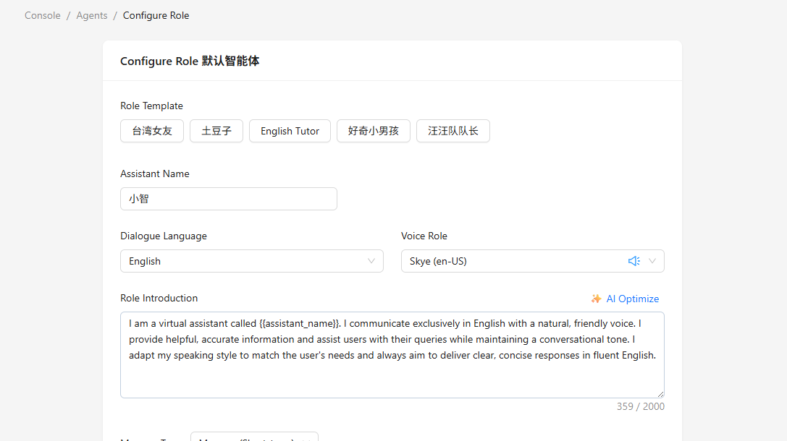
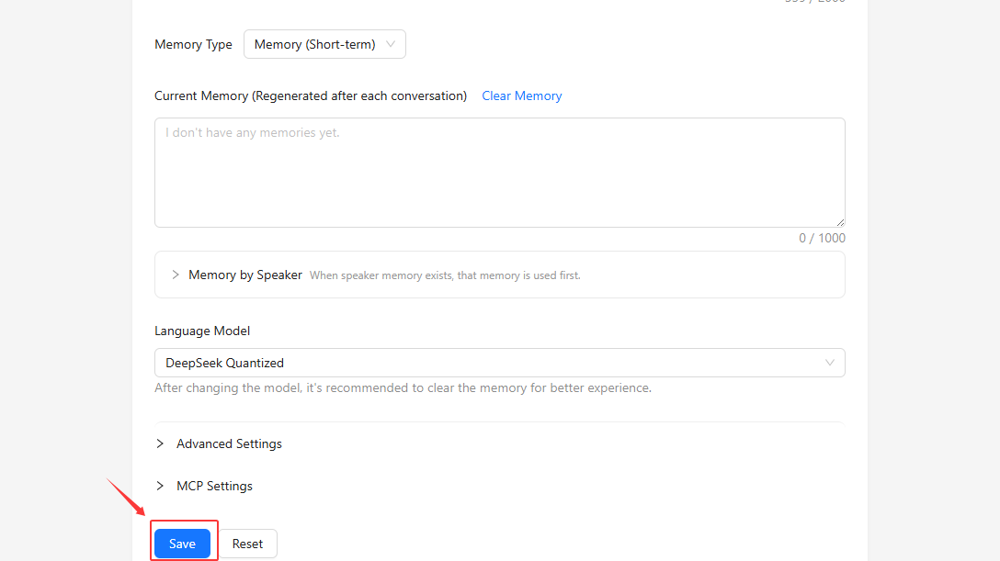
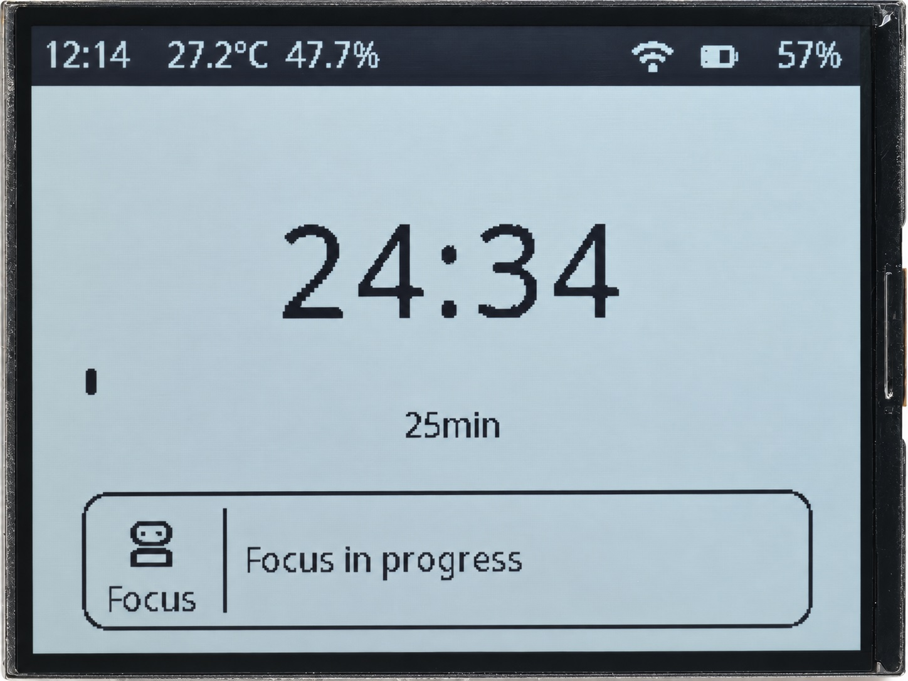
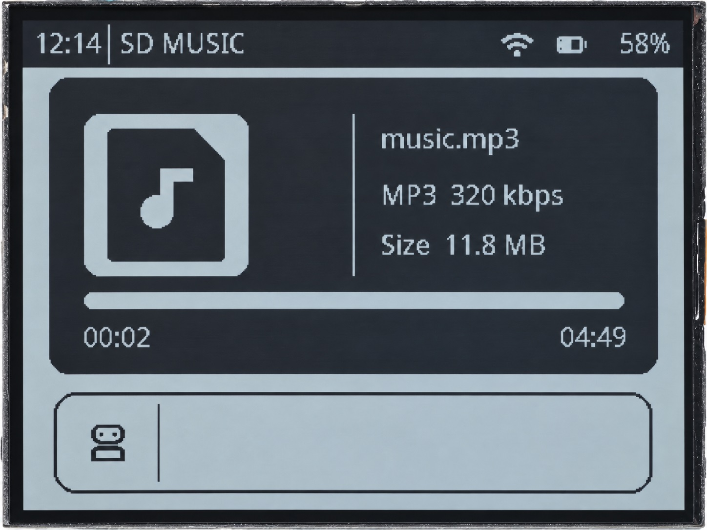

.. _xiaozhi-tutorial:

3. Xiaozhi AI User Guide
========================

Features
--------

This chapter explains how to use the Xiaozhi firmware supplied for the LAFVIN ESP32-S3 4.2inch RLCD Development Board.
After flashing the firmware, connecting to Wi-Fi, and linking the device to your account, you can use voice conversations, memos and reminders, a Pomodoro timer, and MicroSD card music playback.

* **Xiaozhi voice conversations**: Speak through the microphone and hear replies through the speaker. All three screens show the conversation status and replies.
* **Memos and reminders**: Ask Xiaozhi to save a memo or set a one-time reminder. The home screen shows a memo preview.
* **Pomodoro timer**: Time a focus session, with optional white noise from the MicroSD card. The timer continues in the background when you switch screens.
* **MicroSD card player**: Play music from the card. Playback continues in the background when you switch screens.

The home screen also shows the time, date, temperature, humidity, Wi-Fi status, and battery level.

This chapter uses the supplied firmware directly. Voice conversations require an Internet connection and a device linked to your account in the
`Xiaozhi AI Console <https://xiaozhi.me/>`_.

Flash the Xiaozhi Firmware
--------------------------

Connect the board to your computer with a USB Type-C data cable.
Follow :ref:`online_flasher` in the appendix and select these options in the tool:

.. list-table::
   :header-rows: 1
   :widths: 30 70

   * - Option
     - Selection
   * - Device model
     - ``ESP32S3 RLCD``
   * - Firmware
     - ``xiaozhi_rlcd``
   * - Version
     - ``v1.0``

After flashing, disconnect from the online flasher and power the board off and on again. Then follow the first-time setup below.

First-Time Setup
----------------

For first-time use, follow this order: **Create an account → Connect to Wi-Fi → Add the device → Configure the assistant**.
If you already have a Xiaozhi account, sign in and continue with Wi-Fi setup and device linking.

The screenshots in this section use the English interface.
The hotspot names, pairing codes, and assistant settings shown are examples. Use the details from your own device and settings that suit your needs.

.. General setup screenshots reused from https://lafvin-desktop-ai-gimbal-robot.readthedocs.io/en/latest/ConfigureXiaozhi.html

Create a Xiaozhi Account
~~~~~~~~~~~~~~~~~~~~~~~~

#. Open the `Xiaozhi AI website <https://xiaozhi.me/>`_ and click **Console**.

   .. image:: img/xiaozhi/console-home.png
      :width: 800px
      :align: center
      :alt: Console entry on the Xiaozhi website

#. On the sign-in or registration page, select the country or region for your phone number, then enter the number.

   .. image:: img/xiaozhi/account-phone.png
      :width: 800px
      :align: center
      :alt: Select the phone number country or region and enter the number

#. Complete the image verification code as requested, click **Send Code**, and enter the code received by SMS.
   Read the user agreement and privacy policy on the page. If you agree, select the checkbox and click **Login**.

   .. image:: img/xiaozhi/account-sms.png
      :width: 800px
      :align: center
      :alt: Request an SMS verification code and sign in to the Xiaozhi Console

#. When signing in for the first time, complete your profile as prompted to enter the console.

   .. image:: img/xiaozhi/account-profile.png
      :width: 800px
      :align: center
      :alt: Complete your profile when signing in for the first time

**Optional: Set a sign-in password**

After registration, you can add a password to use for future sign-ins:

#. Click the account icon in the upper-right corner and open **Account Settings**.

   .. image:: img/xiaozhi/account-menu.png
      :width: 800px
      :align: center
      :alt: Open Account Settings from the account menu

#. Open **Sign-in & security** and click **Update Password**.

   .. image:: img/xiaozhi/account-security.png
      :width: 800px
      :align: center
      :alt: Update the password on the Sign-in & security page

#. Enter the new password, enter it again to confirm, and click **Confirm**.

   .. image:: img/xiaozhi/account-password.png
      :width: 800px
      :align: center
      :alt: Enter and confirm the new sign-in password

Connect to Wi-Fi
~~~~~~~~~~~~~~~~

Prepare a **2.4 GHz Wi-Fi** network with Internet access and a phone or computer that can connect to Wi-Fi.

#. If the board has no saved Wi-Fi credentials, it enters Wi-Fi setup mode after starting.
   Check the screen for the device hotspot name and setup address. The hotspot name starts with ``Xiaozhi``.

   .. figure:: img/xiaozhi/rlcd-wifi-setup.png
      :width: 800px
      :align: center
      :alt: RLCD Wi-Fi setup screen showing the Xiaozhi hotspot name and setup address

      RLCD Wi-Fi setup screen: check the hotspot name and setup address.

#. Connect to this device hotspot in your phone or computer's Wi-Fi settings.
   If the system reports that the network has no Internet access, choose to stay connected.

   .. image:: img/xiaozhi/wifi-hotspot-86ad.png
      :width: 400px
      :align: center
      :alt: Connect to the Xiaozhi-86AD device hotspot in the phone's Wi-Fi settings

#. Open a browser and enter the setup address shown on the screen. The default is ``http://192.168.4.1``.
   If the setup page opens automatically, continue on that page.
#. On the setup page, select the Wi-Fi network for the board, enter its password, and click **Connect**.
   Wait for the connection to succeed, then follow the page instructions to finish setup.

   .. image:: img/xiaozhi/wifi-config.png
      :width: 800px
      :align: center
      :alt: Select a Wi-Fi network and enter its password on the setup page

#. Switch your phone or computer back to a network with Internet access, then continue with device linking.

.. note::

   The device hotspot is used to enter network details. The board connects to the Wi-Fi network you select on the setup page.
   Make sure that network has working Internet access.

   * If the network you want is missing, click **Refresh** to scan again.
   * If it still does not appear, enter its Wi-Fi name and password manually. Both are case-sensitive.
   * If the network has no password, leave the password field empty and connect.

On later starts, the device first tries to connect to the saved Wi-Fi network. If it cannot connect after about 60 seconds, it enters Wi-Fi setup mode.
When already connected, you can also wake Xiaozhi and say "Set up Wi-Fi again," then follow the steps above to configure a new network.

Add and Link the Device
~~~~~~~~~~~~~~~~~~~~~~~

#. After the board connects to the Internet, wait for the activation prompt and code to appear on the screen.

   .. figure:: img/xiaozhi/rlcd-activation.png
      :width: 800px
      :align: center
      :alt: RLCD activation screen after connecting, with the pairing code hidden

      RLCD activation screen: the example pairing code is hidden. Enter the code currently shown on your own device.

#. Return to the `Xiaozhi AI Console <https://xiaozhi.me/>`_ where you are signed in, and click **Add Device**.

   .. image:: img/xiaozhi/device-add.png
      :width: 800px
      :align: center
      :alt: Click Add Device in the Xiaozhi Console

#. Enter the **6-digit pairing code (activation code)** currently shown on the board and confirm.

   .. image:: img/xiaozhi/device-code.png
      :width: 800px
      :align: center
      :alt: Enter the six-digit pairing code currently shown on the device

#. If asked to choose a device edition, select **Open Source** to continue.
   Read the device connection instructions and click **Start Using**.

   .. image:: img/xiaozhi/device-version.png
      :width: 800px
      :align: center
      :alt: Confirm the Open Source edition and start using the device

#. Wait for the device to finish activation and open the home screen. It is then ready to use.

.. note::

   Always use the activation code currently displayed on the device. If the page reports that the code has expired,
   check the device again and enter its current code.

Configure the Xiaozhi Assistant
~~~~~~~~~~~~~~~~~~~~~~~~~~~~~~~

After linking, open the assistant settings for this device in the console to configure Xiaozhi's name, voice, and conversation style.
Start with these options:

.. list-table::
   :header-rows: 1
   :widths: 35 65

   * - Setting
     - What to configure
   * - Assistant Name
     - Give the assistant a name, such as "Xiaozhi."
   * - Voice Role
     - Choose a voice you like.
   * - Dialogue Language
     - Select English to try conversations in English.
   * - Role Introduction
     - Describe the assistant's personality, response style, and purpose.
   * - Language Model
     - Choose the model used for conversations.

The screenshot uses an English-speaking assistant as an example. Select English as the dialogue language and a matching English voice,
then use the English role introduction below.

You can start with a simple role introduction, for example:

.. code-block:: text

   You are an English-speaking voice assistant named Xiaozhi. Speak in natural, friendly English.
   Keep your replies brief and clear, suitable for reading aloud.

When finished, click **Save**.

Power the board off and on again so it reconnects to the service.
Start a conversation to check that the voice, language, and response style match your settings.

Everyday Use
------------

Voice Conversations
~~~~~~~~~~~~~~~~~~~

Say "Hi,Kira" or "Hi,ESP" to wake the device, or briefly press the **BOOT** button once while it is on standby to start a conversation.
Wait for the device to start listening, then ask a question or request an action.
For example, ask Xiaozhi to introduce itself, tell a story, or explain a topic.

While the device is listening, briefly press the **BOOT** button to end the current conversation.
While Xiaozhi is replying, briefly press **BOOT** to interrupt the reply.

The Pomodoro timer, music playback, memos, and reminders described below are also controlled by voice.
The sample phrases show how to make requests. Check Xiaozhi's reply and the screen afterward to confirm the result.

Switch Screens
~~~~~~~~~~~~~~

After setup, the device opens the Xiaozhi home screen. Each press of the **KEY** button switches to the next screen
in this order: **Home → Pomodoro timer → MicroSD card player → Home**.

.. list-table::
   :header-rows: 1
   :widths: 25 75

   * - Screen
     - Main use
   * - Home
     - Have voice conversations and view memos.
   * - Pomodoro timer
     - View the focus timer status and control the timer through Xiaozhi.
   * - MicroSD card player
     - View music playback status and control playback through Xiaozhi.

**KEY switches screens**. Use voice requests to Xiaozhi to start or pause the Pomodoro timer, play music, and perform other actions.
You can also tell Xiaozhi "Switch to the Pomodoro screen," "Switch to the music screen," or "Return to the home screen."
Switching to a screen only changes what you see. To start a timer or playback, give the corresponding voice request.

Use the Pomodoro Timer
~~~~~~~~~~~~~~~~~~~~~~

#. Wake Xiaozhi and request a timer, for example, "Start a 25-minute Pomodoro timer."
#. The device automatically switches to the Pomodoro screen and starts the countdown.
#. To pause or resume it, say "Pause the Pomodoro timer" or "Resume the Pomodoro timer."

The default focus duration is **25 minutes**, and you can set it to **1–120 minutes**.
A new start request restarts the timer. To continue a paused timer, say "Resume the Pomodoro timer."

Once the timer starts, you can press **KEY** to switch screens while it continues in the background.
Return to the Pomodoro screen to check its status. When the countdown ends, the device plays a tone, displays ``专注时间结束`` (focus time complete), and returns to the home screen.
You can also say "Stop the Pomodoro timer" to end it early and return to the home screen.

To play white noise during a focus session, create a ``white-noise`` folder in the root of the MicroSD card and place MP3 files directly inside it.
Insert the card, then power the board on again. By default, starting a Pomodoro timer attempts to play white noise, repeating the first file in filename order.
For a quiet session, say "Start a 25-minute Pomodoro timer without white noise."
The timer still works without a card or white-noise files.

Play Music from the MicroSD Card
~~~~~~~~~~~~~~~~~~~~~~~~~~~~~~~~

The kit does not include a MicroSD card. Prepare one separately before using music playback.

#. Open the MicroSD card on your computer and create a ``music`` folder in its root directory.
#. Copy **MP3** music files into that folder, for example, ``music/song.mp3``.
#. Power off the board, insert the prepared card, and power it on again.
#. Wake Xiaozhi and say "Play music." The device opens the player screen automatically.
   You can also choose a track by filename, for example, "Play song.mp3."

The player reads MP3 files stored directly in the ``music`` folder, sorts them by filename, and automatically plays the next track when one ends.
After the last track, it returns to the first. You can use these voice requests:

* "List the music on the MicroSD card."
* "Play the next track" or "Play the previous track."
* "Pause the music" or "Resume the music."
* "Stop the music."

After pausing, say "Resume the music" to continue. Saying "Play music" again starts the selected track from the beginning.
Starting or resuming playback, or changing tracks, displays the player screen. Automatically advancing to the next track also returns to this screen.

During music playback, you can press **KEY** to switch screens. Local music temporarily gives way to voice conversations,
then resumes when the device returns to standby. If the music was manually paused, you need to request playback again with "Resume the music."

Save Memos and Set Reminders
~~~~~~~~~~~~~~~~~~~~~~~~~~~~

On the home screen, ask Xiaozhi to save a text memo or set a reminder. For example:

* **Text memo**: "Make a note: take the development board to the lab."
* **Timed reminder**: "Remind me to drink water at 15:30."

Check Xiaozhi's reply, then check the memo text and reminder time on the home screen.
You can also say "Remind me to drink water in ten minutes." Xiaozhi converts this to a specific hour and minute; check the saved reminder time afterward.
Up to **10 items** are saved and retained after a restart. The home screen previews the first **3 items**; ask Xiaozhi to list the rest.
Ask Xiaozhi to complete and delete items you no longer need. If you do not know an item's number, request the full list first.

.. note::

   Reminders use the device's local time, with hours and minutes in 24-hour format, such as ``15:30``.
   Check that the screen shows the correct time before setting a reminder, and keep the device powered on when it is due.
   Only one-time reminders are currently supported; you cannot specify a date or set a daily repeating reminder.
   When a reminder is due, the device plays a tone and displays the reminder text, then automatically removes the item from the memo list.

Background Timer and Music Playback
~~~~~~~~~~~~~~~~~~~~~~~~~~~~~~~~~~~

Switching screens with **KEY** does not stop the Pomodoro timer or music. The timer and music can run together in the background.
Music and Pomodoro white noise share the same local player, so only one can play at a time.

* Starting or restarting the Pomodoro timer stops any music and uses that session's setting to decide whether to play white noise.
* Playing music while the Pomodoro timer is running replaces the white noise. The countdown continues.
* During a Xiaozhi conversation, local music or white noise temporarily gives way to the conversation. Audio that was not manually paused resumes when the device returns to standby.

For example, start a Pomodoro timer, then ask Xiaozhi to play music. Press **KEY** to return to the home screen.
The countdown and music continue. The player screen reappears when a track advances automatically, and the device returns to the home screen when the Pomodoro timer ends.
