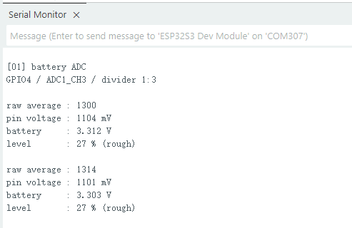

.. _arduino-adc-battery:

1. ADC Battery Voltage Measurement
==================================

Overview
--------

This lesson reads the board's battery-sensing pin and prints the results over serial.
The ADC converts the pin voltage into a number. The serial output shows the raw
reading, pin voltage, battery voltage, and estimated battery level so you can compare them.

This example does not drive the RLCD. The screen may still show the previous image
after uploading. Use the Serial Monitor to view the results.

Setup
-----

No code parameters need changing, and no third-party Arduino libraries are required.
Complete the following connections and settings before running the example:

* Complete the settings in :ref:`arduino-board-settings`.
* Connect the board to your computer with a USB Type-C data cable and keep it connected during the experiment.
* Correctly connect a compatible 18650 battery.
* Have a multimeter ready if you want to compare voltage readings.

.. warning::
   Battery measurement uses the onboard voltage divider, so no extra wiring is needed.
   Disconnect power before connecting or removing the battery, and check the battery connector polarity.

Run the Example
^^^^^^^^^^^^^^^

Download the example code to your computer as described in :ref:`download-code`.
Open ``examples/arduino/01_adc_battery/01_adc_battery.ino``, compile it, and upload it.
After uploading, open the Serial Monitor and set the baud rate to **115200**.

View the Results
^^^^^^^^^^^^^^^^

At startup, the program prints the example name, then outputs a set of readings about once per second.
The numbers below illustrate the format; they are not recorded measurements.
Actual values depend on the battery, power state, and board:

.. code-block:: text

   [01] battery ADC
   GPIO4 / ADC1_CH3 / divider 1:3

   raw average : 1684
   pin voltage : 1261 mV
   battery     : 3.783 V
   level       : 69 % (rough)

.. list-table::
   :header-rows: 1
   :widths: 25 75

   * - Output
     - Meaning
   * - raw average
     - Average raw ADC reading, with no voltage unit
   * - pin voltage
     - Average voltage at GPIO4, in millivolts
   * - battery
     - Battery terminal voltage calculated using the onboard divider ratio, in volts
   * - level
     - Approximate battery percentage estimated from voltage

This example measures the battery-sensing circuit, not the USB input voltage.
Readings taken without a battery do not represent an actual battery level.
If the average pin voltage is zero, the program prints ``ADC read failed`` instead.
This message can appear when no battery is connected or an ADC read fails;
it does not by itself indicate a hardware fault.

Code Walkthrough
----------------

ADC Configuration
^^^^^^^^^^^^^^^^^

Battery sensing uses GPIO4 (ADC1_CH3). The onboard resistor network divides
the battery voltage by three before feeding it to this pin.
In ``battery_bsp.cpp``, ``batteryBegin()`` sets the reading resolution and voltage range:

.. code-block:: cpp

   void batteryBegin() {
     analogReadResolution(12);
     // Attenuation extends the ADC range; it is separate from the onboard divider and does not replace multiplying voltage by 3.
     analogSetPinAttenuation(PIN_BATTERY_ADC, ADC_11db);
   }

The 12-bit raw reading ranges from 0–4095. ``ADC_11db`` adjusts the ADC's measurable
voltage range. This is separate from the board's resistor divider, so the voltage
must still be multiplied by 3 when calculating the battery voltage.

Sampling and Voltage Conversion
^^^^^^^^^^^^^^^^^^^^^^^^^^^^^^^

``batteryRead(16)`` takes 16 sets of readings and averages each type separately.
``analogRead()`` provides raw readings, while ``analogReadMilliVolts()`` provides
calibrated millivolt values. Each function takes its own samples; these are not
two representations of the same conversion. Averaging helps reduce random fluctuations.

The program converts the average millivolt value to battery voltage:

.. code-block:: cpp

   sample.batteryVoltage = sample.pinMillivolts / 1000.0f *
                           BATTERY_DIVIDER_RATIO;
   sample.estimatedPercent = estimatePercent(sample.batteryVoltage);

It first divides by 1000 to convert millivolts to volts, then multiplies by
``BATTERY_DIVIDER_RATIO``, which is 3 for this board.
For example, a pin voltage of 1261 mV gives a battery voltage of 3.783 V.

Estimating Battery Level
^^^^^^^^^^^^^^^^^^^^^^^^

``estimatePercent()`` displays 0% at 3.00 V or below and 100% at 4.12 V or above,
with a proportional integer percentage between them. These two voltages are used
only to calculate the displayed percentage, not as battery protection thresholds.
Load, temperature, and charging state also affect voltage, so this percentage is only a rough estimate.

Example Output
--------------

   Serial output from battery voltage measurement.

References
----------

* `Arduino-ESP32 ADC API <https://docs.espressif.com/projects/arduino-esp32/en/latest/api/adc.html>`_
* `Arduino-ESP32 USB CDC Configuration <https://docs.espressif.com/projects/arduino-esp32/en/latest/tutorials/cdc_dfu_flash.html>`_
