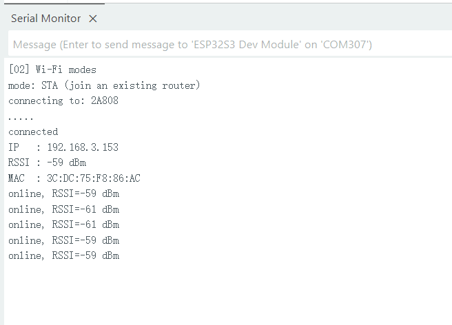

.. _arduino-wifi-modes:

2. Wi-Fi STA and AP Modes
=========================

Overview
--------

This lesson introduces the board's Wi-Fi features through two modes:

* **AP mode**: The board creates a hotspot for a phone or computer to join and prints the number of connected devices over serial.
* **STA mode**: The board joins an existing wireless router and prints its IP address, signal strength, and MAC address over serial.

The example uses AP mode by default and runs only one mode at a time.
It uses serial output only; it does not drive the RLCD or provide a web page.

Setup
-----

Download the example code to your computer as described in :ref:`download-code`,
then open ``examples/arduino/02_wifi_modes/02_wifi_modes.ino``.
This example uses the WiFi library included with the board package; no third-party library is required.

Set the mode and network parameters in ``examples/arduino/02_wifi_modes/app_config.h``.
Choose one mode as described below. Recompile and upload after making changes for them to take effect.

AP: Create a Local Hotspot
^^^^^^^^^^^^^^^^^^^^^^^^^^

The default configuration is ready to use, with no parameter changes required:

.. code-block:: cpp

   #define APP_WIFI_MODE APP_WIFI_MODE_AP

   #define APP_WIFI_AP_SSID            "ESP32S3-RLCD"
   #define APP_WIFI_AP_PASSWORD        "12345678"
   #define APP_WIFI_AP_CHANNEL         1
   #define APP_WIFI_AP_MAX_CONNECTIONS  4

These settings specify the operating mode, hotspot name, password, channel,
and maximum number of connected devices. Keep the double quotes when changing
the name or password, and use 8–63 characters for the password.

#. Check :ref:`arduino-board-settings`, then compile and upload the program.
#. Open the Serial Monitor and set the baud rate to **115200**.
#. On your phone or computer, join **ESP32S3-RLCD** using the password **12345678**.
   If you changed the configuration, use your updated name and password.

The serial output has the following format. Use the IP address shown by your board:

.. code-block:: text

   [02] Wi-Fi modes
   mode: AP (create a local hotspot)
   SSID : ESP32S3-RLCD
   IP   : 192.168.4.1
   The AP does not provide Internet access.
   connected devices: 0

When one device connects, the serial output shows ``connected devices: 1``.
The count decreases when a device disconnects. The program checks once per second
and prints only when the count changes.

.. note::
   A "No Internet access" message on your phone is normal; choose to stay connected.
   This hotspot provides a local connection and does not share Internet access.
   The printed IP address belongs to the board's hotspot. This example has no web page,
   so you do not need to open that address in a browser after connecting.

STA: Connect to a Router
^^^^^^^^^^^^^^^^^^^^^^^^

Have an available **2.4 GHz Wi-Fi** network ready and change the following three settings
in the same configuration file. Replace the two empty strings with your network name
and password, keeping the double quotes:

.. code-block:: cpp

   #define APP_WIFI_MODE APP_WIFI_MODE_STA
   #define APP_WIFI_SSID       ""
   #define APP_WIFI_PASSWORD   ""

Enter the details of your router or phone hotspot here. These are separate from
the AP settings used to create the board's hotspot above. This example connects
using a network name and password; it does not support web sign-in or enterprise authentication.

Recompile and upload, then open the Serial Monitor at **115200** baud.
A successful connection produces output like the following. The network name,
addresses, and signal value illustrate the format; they are not recorded measurements.

.. code-block:: text

   [02] Wi-Fi modes
   mode: STA (join an existing router)
   connecting to: MyWiFi
   ....
   connected
   IP   : 192.168.1.23
   RSSI : -52 dBm
   MAC  : 10:20:30:40:50:60

IP is the address assigned to the board by the router, RSSI is the received Wi-Fi
signal strength, and MAC is the wireless interface address. While connected,
the program prints ``online, RSSI=... dBm`` about every five seconds.

If you see ``Set APP_WIFI_SSID and APP_WIFI_PASSWORD in app_config.h.``,
the network name is still empty. If you see ``connection timeout; will retry later``,
check the name, password, and availability of the 2.4 GHz network, then wait for a retry.
Remove your real Wi-Fi password before sharing the configuration file or screenshots.

Code Walkthrough
----------------

Creating a Hotspot
^^^^^^^^^^^^^^^^^^

At compile time, ``02_wifi_modes.ino`` uses ``APP_WIFI_MODE`` to include only
the code for the selected mode. AP mode first sets the operating mode,
then creates a hotspot using the configuration parameters:

.. code-block:: cpp

   WiFi.mode(WIFI_AP);

   if (!WiFi.softAP(APP_WIFI_AP_SSID, APP_WIFI_AP_PASSWORD,
                    APP_WIFI_AP_CHANNEL, 0, APP_WIFI_AP_MAX_CONNECTIONS)) {
     Serial.println(F("AP start failed"));
     return;
   }

``WiFi.softAP()`` returns whether startup succeeded. The ``0`` argument means
the hotspot name is not hidden. After startup, the program gets the hotspot
address with ``WiFi.softAPIP()`` and the number of connected devices with
``WiFi.softAPgetStationNum()``.

Connecting to a Router
^^^^^^^^^^^^^^^^^^^^^^

STA mode starts a connection using the network name and password from the configuration file:

.. code-block:: cpp

   WiFi.mode(WIFI_STA);
   WiFi.begin(APP_WIFI_SSID, APP_WIFI_PASSWORD);

The program checks the connection with ``WiFi.status()`` and prints connection
details when the status is ``WL_CONNECTED``. AP settings are used only to create
a hotspot; STA settings are used only to join an existing network.

Connection Timeouts and Retries
^^^^^^^^^^^^^^^^^^^^^^^^^^^^^^^

The connection timeout and retry interval are also defined in the configuration file:

.. code-block:: cpp

   #define APP_WIFI_CONNECT_TIMEOUT_MS 10000U
   #define APP_WIFI_RETRY_INTERVAL_MS  15000U

By default, each connection attempt waits up to 10 seconds, during which the main
loop pauses. After a failure, control returns to the main loop, which calls the
connection function again according to the retry interval. The 15-second interval
starts at the beginning of the previous attempt and includes the time already spent waiting.
If the network name is empty, the program only asks you to complete the settings;
it does not retry periodically.

Example Output
--------------

   Serial output after connecting to Wi-Fi in STA mode.

References
----------

* `Arduino-ESP32 Wi-Fi API <https://docs.espressif.com/projects/arduino-esp32/en/latest/api/wifi.html>`_
