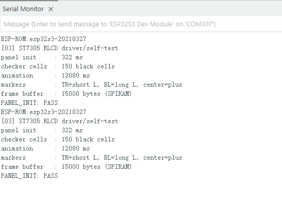

.. _arduino-rlcd-driver:

3. RLCD Driver and Display Self-Test
====================================

Overview
--------

This lesson uses the included ST7305 driver to control the reflective LCD.
You will learn how to initialize the display, draw pixels, and update the full image.
The program draws a checkerboard one cell at a time, then displays orientation
markers so you can check the image orientation and edges.

This example uses a 400 × 300 landscape layout. U8g2 and other third-party display libraries are not required.

Setup
-----

No code parameters need changing. Complete :ref:`arduino-board-settings` and
make sure **PSRAM is set to OPI PSRAM**, then download the code as described in
:ref:`download-code`. Open ``examples/arduino/03_rlcd_driver/03_rlcd_driver.ino``,
compile it, and upload it. Set the Serial Monitor to **115200** baud.

Expected Results
^^^^^^^^^^^^^^^^

After power-on, the display follows this sequence:

#. The screen clears to white, then black checkerboard cells appear one by one, row by row.
#. After the checkerboard is complete, the screen clears to white again.
#. The final image shows a short L marker at the top right, a long L marker at the bottom left, and a cross in the center.

The different lengths of the two L markers help you see whether the image is upside down.
The checkerboard does not remain in the final image, and the animation does not repeat.
Reset the board to run it again.

The serial output reports initialization time, black cell count, animation time,
and the memory required to store the image. The default layout contains 150 black
cells, and the image uses 15000 bytes. ``PANEL_INIT: PASS`` means the program
completed initialization and the test sequence; you still need to inspect the screen to check the image.

Code Walkthrough
----------------

Preparing the Image in Memory
^^^^^^^^^^^^^^^^^^^^^^^^^^^^^

The program first prepares the full image in a memory area called the frame buffer.
``display_bsp.cpp`` allocates this memory during initialization:

.. code-block:: cpp

   frameBytes_ = width_ * height_ / 8;
   frameBuffer_ = (uint8_t *)heap_caps_malloc(frameBytes_, MALLOC_CAP_SPIRAM);

Each monochrome pixel uses 1 bit, so 400 × 300 pixels require 15000 bytes.
The image is stored in PSRAM, which is why OPI PSRAM must be enabled in the board settings.
``begin()`` then resets the display, writes its startup parameters, and clears the image in memory to white.

Drawing and Refreshing
^^^^^^^^^^^^^^^^^^^^^^

The main program adds one black cell at a time, then calls the refresh function:

.. code-block:: cpp

   fillCell(column * kCheckerCell, row * kCheckerCell,
            kCheckerCell, LCD_PIXEL_BLACK);
   // Only one cell is added, but each flush() still submits a full frame; the delay makes it visible.
   panel.flush();

``setPixel()`` changes only the pixels in memory. ``flush()`` submits the image
data to the SPI interface for transmission. Even though only one cell is added
each time, the entire image is sent. ``flush()`` returns after submitting the
transfer to SPI; transmission may not yet be complete at that point.

Locating Pixels by Coordinates
^^^^^^^^^^^^^^^^^^^^^^^^^^^^^^

The ST7305 stores pixels in a different order from a typical row-by-row image.
The driver finds the byte and bit for each pixel, so drawing code only needs to
provide coordinates. This example uses 0 for white and 1 for black.
Display orientation settings and coordinate calculations must be changed together;
changing only the orientation settings may scramble the image.

Example Output
--------------

   Serial output from the RLCD driver self-test.

References
----------

* `ESP-IDF SPI LCD Interface <https://docs.espressif.com/projects/esp-idf/en/v5.4/esp32s3/api-reference/peripherals/lcd/spi_lcd.html>`_
