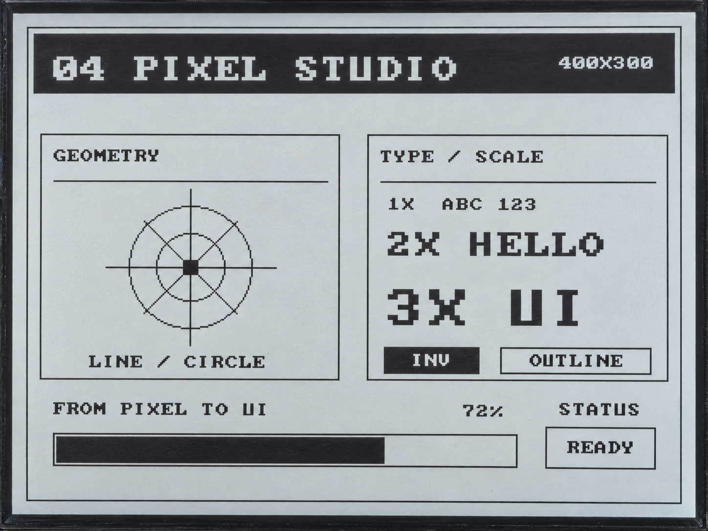

.. _arduino-hello-rlcd:

4. Drawing Graphics and Text
============================

Overview
--------

This lesson uses the display driver to draw lines, rectangles, circles, and text,
then combines them into a static ``PIXEL STUDIO`` interface. The screen includes
geometric shapes, text in different sizes, white-on-black labels, and a progress bar.

This example does not require LVGL or read the clock, sensors, or network.
The progress bar displays a fixed value from the program; it does not represent
battery level or the progress of an actual task.

Setup
-----

No code parameters need changing, and no third-party libraries are required.
Complete :ref:`arduino-board-settings`, download the code as described in
:ref:`download-code`, then open ``examples/arduino/04_hello_rlcd/04_hello_rlcd.ino``.
Compile and upload it, and set the Serial Monitor to **115200** baud.

Expected Results
^^^^^^^^^^^^^^^^

The screen displays a static 400 × 300 page: a white-on-black title at the top,
geometric shapes made from lines and circles on the left, bitmap text and labels
at 1×, 2×, and 3× sizes on the right, and a 72% progress bar at the bottom.
The program draws the page only once and does not automatically update the progress bar.

The serial output has the following format; the ellipses stand for the measured times in milliseconds:

.. code-block:: text

   [04] pixel studio
   draw page : ... ms
   flush     : ... ms

The page coordinates are designed for landscape orientation.
Switching to portrait also requires changes to the layout.

Code Walkthrough
----------------

Building an Interface from Shapes
^^^^^^^^^^^^^^^^^^^^^^^^^^^^^^^^^

The example's ``draw_bsp.cpp`` provides functions for drawing lines, rectangles,
circles, and text. The main program first clears the background, then draws each region:

.. code-block:: cpp

   panel.clearBuffer(LCD_PIXEL_WHITE);
   drawRect(panel, 8, 8, 384, 284, LCD_PIXEL_BLACK);
   drawHeader();
   drawGeometryCard();
   drawTypographyCard();
   drawFooter();

These functions draw into memory first. ``panel.flush()`` is called only after
the whole page is ready to send it to the display. In the serial output,
``draw page`` is the drawing time and ``flush`` is the time spent submitting the
transfer, not the time needed to finish displaying the image.

White Text on a Black Background
^^^^^^^^^^^^^^^^^^^^^^^^^^^^^^^^

White-on-black text is created by drawing the background first, then the text:

.. code-block:: cpp

   fillRect(panel, 12, 12, 376, 36, LCD_PIXEL_BLACK);
   drawString(panel, 24, 26, "04 PIXEL STUDIO", LCD_PIXEL_WHITE, 2);

The last argument of ``drawString()`` is the text scale factor. Each character
uses an 8 × 8 pixel grid. At a scale factor of 2, each pixel becomes a 2 × 2 block.
This ASCII font supports English letters, numbers, and common symbols, but not Chinese characters.

Progress Bar
^^^^^^^^^^^^

The program uses the fixed value ``kProgressValue = 72`` to calculate the fill width.
``drawProgressBar()`` draws a rectangular border, then fills the inside according
to the percentage. This shows how simple shapes can form a control; the later
LVGL lesson uses ready-made widgets.

Example Output
--------------

   Graphics, text, and a progress bar on the display.

References
----------

* :ref:`arduino-rlcd-driver`
