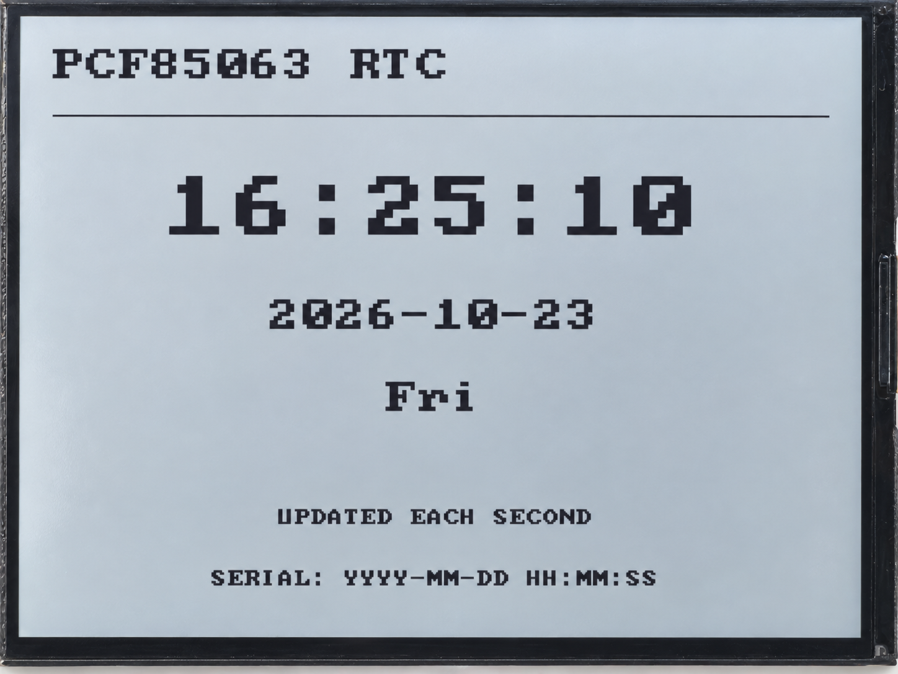

.. _arduino-rtc:

5. RTC Real-Time Clock
======================

Overview
--------

This lesson reads the PCF85063 real-time clock over I2C, displays the time, date,
and day of the week on the RLCD, and sets the time over serial. The RTC keeps time
independently; the program reads it and updates the display once per second.

The program checks whether the time is reliable. If the RTC reports that its clock
has stopped, or the date is invalid, the display asks you to set the time instead
of presenting an unreliable value as normal time.

Setup
-----

No code parameters need changing, and no third-party libraries are required.
Configure the board using :ref:`arduino-board-settings` and download the code as
described in :ref:`download-code`. Open
``examples/arduino/05_rtc_pcf85063/05_rtc_pcf85063.ino``, compile it, and upload it.

Setting the Time over Serial
^^^^^^^^^^^^^^^^^^^^^^^^^^^^

#. Open the Serial Monitor, set the baud rate to **115200**, and select **Newline** as the line ending.
#. If the time is incorrect, enter and send the current time in ``YYYY-MM-DD HH:MM:SS`` format.
   The line below is an example; replace it with the actual time rather than using the example date.

   .. code-block:: text

      2026-10-16 12:34:56

#. After a successful update, the serial output shows ``RTC set OK ->`` followed by the time read back from the RTC, and the display updates.

The program supports years 2000–2099 and calculates the day of the week from
the entered date, so you do not need to specify it. You can use the same method
to correct the time even if a valid time is available at startup.

Expected Results
^^^^^^^^^^^^^^^^

When the time is valid, the display updates the hours, minutes, and seconds every
second, with the date and day of the week below. Invalid time produces
``RTC TIME UNAVAILABLE`` and ``SET VIA SERIAL``. If the serial output reports
a format error, check the date, separators, and line-ending setting.

Code Walkthrough
----------------

Reading Time Data
^^^^^^^^^^^^^^^^^

``examples/arduino/05_rtc_pcf85063/rtc_bsp.cpp`` reads seven consecutive bytes starting at the seconds register:

.. code-block:: cpp

   uint8_t raw[7];
   if (!i2cReadRegs(dev_, 0x04, raw, sizeof(raw))) return false;

The chip stores values such as seconds and minutes in BCD, which stores the tens
and units digits separately. For example, 59 is stored as ``0x59``. The program
first removes the chip status bits from each byte, then converts it to a number.
The two-digit year is interpreted as 2000–2099.

Checking Time Reliability
^^^^^^^^^^^^^^^^^^^^^^^^^

The main program displays normal time only when communication succeeds,
the chip does not report an oscillator stop (``!osFlag``), and the date is valid:

.. code-block:: cpp

   if (rtc.read(&now, &osFlag) && !osFlag && isValidDateTime(now)) {
     printTime(now, false);
     drawRtcScreen(&now, true, "UPDATED EACH SECOND");
   }

The OS flag means the chip's timekeeping oscillator has stopped and the time may
be unreliable; it does not indicate battery level. When setting the time, the
program writes it, reads it back, and reports success only after confirming it is valid.

Example Output
--------------

   PCF85063 time, date, and day of the week on the display.

References
----------

* `NXP PCF85063A Datasheet <https://www.nxp.com/docs/en/data-sheet/PCF85063A.pdf>`_
