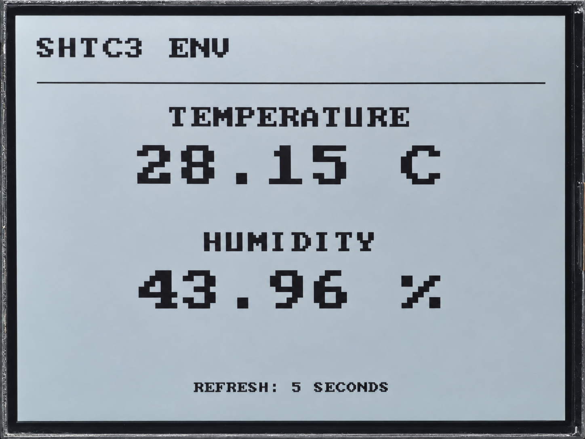

.. _arduino-shtc3:

6. Temperature and Humidity Measurement
=======================================

Overview
--------

This lesson reads the onboard SHTC3 temperature and humidity sensor every five
seconds and shows the measurements over serial and on the RLCD. The program
checks the CRC values supplied by the sensor to detect data transmission errors.

Setup
-----

No code parameters need changing, and no third-party libraries are required.
Complete :ref:`arduino-board-settings`, download the code as described in
:ref:`download-code`, then open ``examples/arduino/06_shtc3_env/06_shtc3_env.ino``.
Compile and upload it. This example uses the onboard sensor, so no external sensor
or network connection is needed. Set the Serial Monitor to **115200** baud.

Expected Results
^^^^^^^^^^^^^^^^

The screen shows temperature and relative humidity. After a successful read,
the chip ID appears at the top right. The serial output has the following format;
use the ID and readings shown by your board. These are not recorded measurements:

.. code-block:: text

   [06] SHTC3 environment sensor
   PANEL_INIT: PASS
   chip ID: 0x0807
   T = 26.31 C, RH = 58.20 %

If measurement fails, the screen shows ``MEASURE FAILED`` and an I2C or CRC error.
I2C indicates a communication failure; CRC indicates that the received data failed
validation. Measurements from a failed cycle are not displayed.

Code Walkthrough
----------------

Waking and Reading the Sensor
^^^^^^^^^^^^^^^^^^^^^^^^^^^^^

``examples/arduino/06_shtc3_env/shtc3_bsp.cpp`` controls the sensor with 16-bit commands.
To begin a measurement, it wakes the sensor, then sends a measurement command
requesting temperature first, followed by humidity:

.. code-block:: cpp

   if (!sendCommand(0x3517)) return SHTC3_ERR_I2C;
   delay(1);

   // 2) Start measurement: normal mode, temperature first, no clock stretching.
   if (!sendCommand(0x7866)) return SHTC3_ERR_I2C;

The program then waits 15 ms and reads six bytes: two for temperature and two
for humidity, each followed by a one-byte CRC. After reading all the data,
it attempts to return the sensor to sleep.

Validating and Converting the Data
^^^^^^^^^^^^^^^^^^^^^^^^^^^^^^^^^^

Temperature and humidity are checked separately before conversion to measured values:

.. code-block:: cpp

   if (crc8(&raw[0], 2) != raw[2]) return SHTC3_ERR_CRC;
   if (crc8(&raw[3], 2) != raw[5]) return SHTC3_ERR_CRC;

Once both checks pass, the program uses the datasheet formulas to calculate
temperature in degrees Celsius and relative humidity:

.. code-block:: cpp

   out->temperatureC = -45.0f + 175.0f * (float)rawT / 65536.0f;
   out->humidityPct = 100.0f * (float)rawH / 65536.0f;

Example Output
--------------

   SHTC3 temperature and humidity on the display.

References
----------

* `Sensirion SHTC3 Datasheet <https://sensirion.com/media/documents/643F9C8E/63A5A436/Datasheet_SHTC3.pdf>`_
