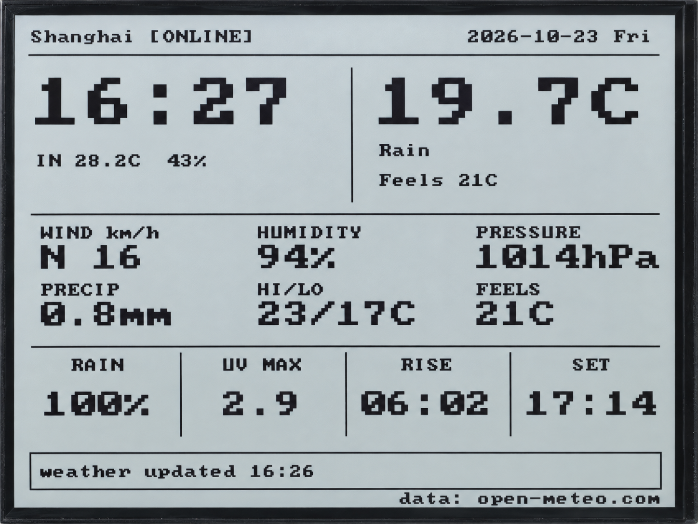

.. _arduino-network-weather:

8. Online Weather Dashboard
===========================

Overview
--------

This lesson connects to Wi-Fi, retrieves Open-Meteo weather data, and attempts
to set the RTC using network time. The display combines city weather, the date
and time, and indoor temperature and humidity from the onboard SHTC3 on one page.
Indoor readings come from the sensor, while city weather comes from the Internet,
so the values may differ.

Setup
-----

Complete :ref:`arduino-board-settings`, download the code as described in
:ref:`download-code`, then open
``examples/arduino/08_network_weather/08_network_weather.ino``.
Install **ArduinoJson 7.3.0** through the Arduino IDE Library Manager.

Network and City
^^^^^^^^^^^^^^^^

Open ``examples/arduino/08_network_weather/app_config.h`` and enter the name
and password of a 2.4 GHz Wi-Fi network with Internet access:

.. code-block:: cpp

   #define APP_WIFI_SSID       ""
   #define APP_WIFI_PASSWORD   ""

Replace the empty strings with your details, keeping the double quotes.
This example does not require a weather API key. Remove your real Wi-Fi password
before sharing code or screenshots.

The default city is Shanghai. You can change it in the same file:

.. code-block:: cpp

   #define APP_WEATHER_CITY        "Shanghai"
   #define APP_WEATHER_LATITUDE    31.2304f
   #define APP_WEATHER_LONGITUDE   121.4737f
   #define APP_TIME_ZONE    "CST-8"
   #define APP_NTP_SERVER   "pool.ntp.org"

The city name is only for display; use English or pinyin. Latitude and longitude
determine the weather location. These are numeric values and do not use double quotes.
The time zone string ``CST-8`` used in this example means UTC+8. If you change
to another region, also adjust the time zone. Recompile and upload after making changes.

Running and Using the Example
^^^^^^^^^^^^^^^^^^^^^^^^^^^^^

Open the Serial Monitor at **115200** baud. At startup, the program connects to
Wi-Fi, attempts to synchronize the time, requests weather data, and displays the
page in that order. During normal operation, the serial output shows the
connection address and weather temperature.

* By default, weather data is requested every fifteen minutes and indoor temperature and humidity are sampled every thirty seconds.
* The RTC is read every second. The page clock displays hours and minutes; changes in other data may also trigger a refresh.
* Press the KEY button to attempt a connection when offline, or request weather immediately when online.
* If no network is configured, the page asks you to set up Wi-Fi. After a disconnection, the program retries at the default interval.

If a weather request fails, the program displays an error and keeps the last
successful data. The program waits for network connection, time synchronization,
and weather requests to finish. Button handling and page updates pause during these waits.

Code Walkthrough
----------------

Connecting and Synchronizing Time
^^^^^^^^^^^^^^^^^^^^^^^^^^^^^^^^^

After connecting, the main program calls ``syncClock()`` to start system time synchronization over the network:

.. code-block:: cpp

   configTzTime(APP_TIME_ZONE, APP_NTP_SERVER);

Once a valid system time is available, the program attempts to write it to the
RTC, then reads the RTC for display. If synchronization times out but the RTC
still has valid time, the program continues using the RTC.

Retrieving Weather Data
^^^^^^^^^^^^^^^^^^^^^^^

``examples/arduino/08_network_weather/weather.cpp`` requests weather data using
HTTPClient, then uses ArduinoJson to read the weather fields from the response text:

.. code-block:: cpp

   JsonDocument document;
   const DeserializationError jsonError = deserializeJson(document, payload);

The program reads current weather and the day's forecast separately. It updates
the stored weather data only after confirming a successful request and the presence
of all required fields. City coordinates are used for the weather request;
the city name is used only in the page title.

Controlling the Refresh Interval
^^^^^^^^^^^^^^^^^^^^^^^^^^^^^^^^

The following setting determines the weather request interval:

.. code-block:: cpp

   #define APP_WEATHER_REFRESH_MS  (15UL * 60UL * 1000UL)

The main loop uses the time since the last request to decide when to fetch weather
again. It sets ``dirty`` to ``true`` when the page needs updating. This interval
controls when the program makes requests, not how often the weather service updates its data.

Example Output
--------------

   Online weather and indoor temperature and humidity on the display.

References
----------

* `Open-Meteo Weather API Documentation <https://open-meteo.com/en/docs>`_
* `ArduinoJson 7: deserializeJson() <https://arduinojson.org/v7/api/json/deserializejson/>`_
