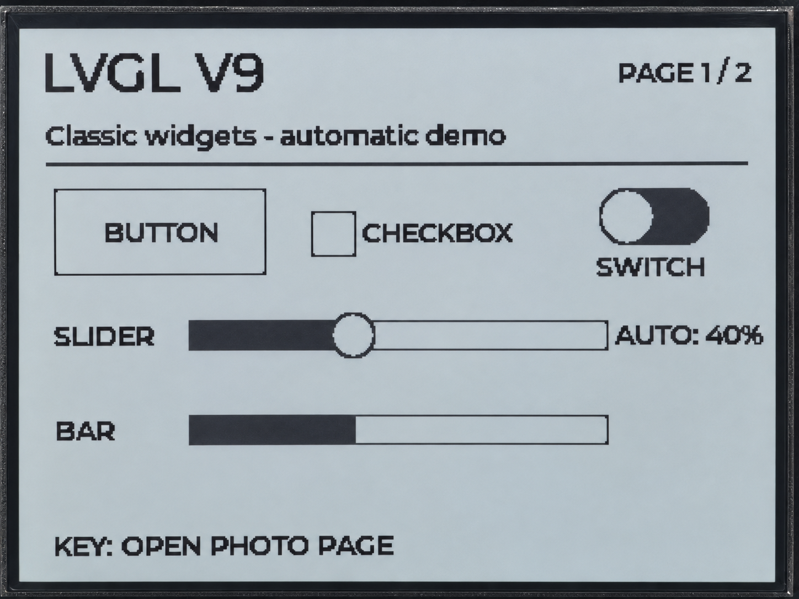

.. _arduino-lvgl-ui:

10. LVGL Interface and Photo Display
====================================

Overview
--------

This lesson uses LVGL 9 to create two pages. The first shows text, a button,
a checkbox, a switch, a slider, and a progress bar. The second alternates between
two built-in photos. Use the KEY button to switch pages.

This board does not have a touchscreen. The program changes the widgets on the
first page automatically; you do not need to tap the screen. The photos are
included in the example resources, so no MicroSD card or network connection is needed.

Setup
-----

No application parameters need changing, but LVGL must be installed and configured.
Download the code as described in :ref:`download-code`, then open
``examples/arduino/10_lvgl_ui/10_lvgl_ui.ino``.

Installing and Configuring LVGL
^^^^^^^^^^^^^^^^^^^^^^^^^^^^^^^

#. Install **LVGL 9.3.0** through the Arduino IDE Library Manager.
#. Copy ``examples/arduino/10_lvgl_ui/lv_conf.h`` to the libraries folder
   inside your Arduino Sketchbook, alongside the lvgl library folder.
   You can find the Sketchbook location in the Arduino IDE preferences.

   .. code-block:: text

      <Sketchbook>/libraries/lv_conf.h
      <Sketchbook>/libraries/lvgl/

#. Check :ref:`arduino-board-settings`, especially **OPI PSRAM** and **16MB Flash**.
#. Keep the example's complete src resource directory, then compile and upload. Set the Serial Monitor to **115200** baud.

If the program reports that the configuration file has not taken effect or that
the color depth is incorrect, check the location of lv_conf.h. Do not simply
remove the configuration checks from the program.

Expected Results
^^^^^^^^^^^^^^^^

At power-on, the first page appears with ``LVGL V9`` at the top left.
The Slider and Bar change value every second. At 50% or above, the Checkbox
and Switch show their checked or on states.

Press the KEY button to open the photo page. Every three seconds, the program
checks whether this page is active and, if so, changes the photo. The photo number
appears at the top left. Press KEY again to return to the first page.
The current photo is preserved when switching pages, and photos do not continue
changing while the photo page is hidden. The serial output reports the page and photo numbers.

Code Walkthrough
----------------

Adding Text to a Button
^^^^^^^^^^^^^^^^^^^^^^^

``examples/arduino/10_lvgl_ui/ui_bsp.cpp`` creates a button, then uses
``lv_label_create(button)`` to add text inside it:

.. code-block:: cpp

   lv_obj_t *button = lv_button_create(page);
   lv_obj_set_size(button, 112, 46);
   lv_obj_set_pos(button, 18, 84);
   lv_obj_t *buttonText = lv_label_create(button);
   lv_label_set_text(buttonText, "BUTTON");
   lv_obj_center(buttonText);

The widgets on both pages are created only at startup. Switching pages hides
or shows the corresponding page.

Timed Updates
^^^^^^^^^^^^^

Two timers are created after the interface is built:

.. code-block:: cpp

   lv_timer_create(widgetTimerCb, 1000, nullptr);
   // Page 2 switches photos every 3 seconds; leaving that page preserves the current photo.
   lv_timer_create(photoTimerCb, 3000, nullptr);

The main loop repeatedly calls ``lvglPortTask(20)`` to check timers, run the
corresponding update functions, and handle layout and redrawing. All of these
operations run in sequence within the main loop.

Output to the Monochrome Display
^^^^^^^^^^^^^^^^^^^^^^^^^^^^^^^^

``examples/arduino/10_lvgl_ui/lvgl_port.cpp`` sets the display format to I1:

.. code-block:: cpp

   s_disp = lv_display_create(panel->width(), panel->height());
   lv_display_set_color_format(s_disp, LV_COLOR_FORMAT_I1);

I1 uses 1 bit per monochrome pixel. The 400 × 300 pixel data requires 15000 bytes,
plus 8 bytes at the beginning to describe the two colors, black and white.
During a refresh, ``flushToRlcd()`` skips those 8 bytes, rearranges the pixels
into the format required by the display driver, and submits them to the driver.
The two formats differ in pixel order and the meaning of their black/white values,
so the data cannot simply be copied as a whole.

Example Output
--------------

   LVGL automatic widget demonstration page.

.. figure:: ../img/10-2_phen.png
   :alt: LVGL photo display page
   :width: 800px
   :align: center

   LVGL photo display page.

References
----------

* `LVGL 9.3 Arduino Integration <https://docs.lvgl.io/9.3/details/integration/framework/arduino.html>`_
* :ref:`arduino-rlcd-driver`
