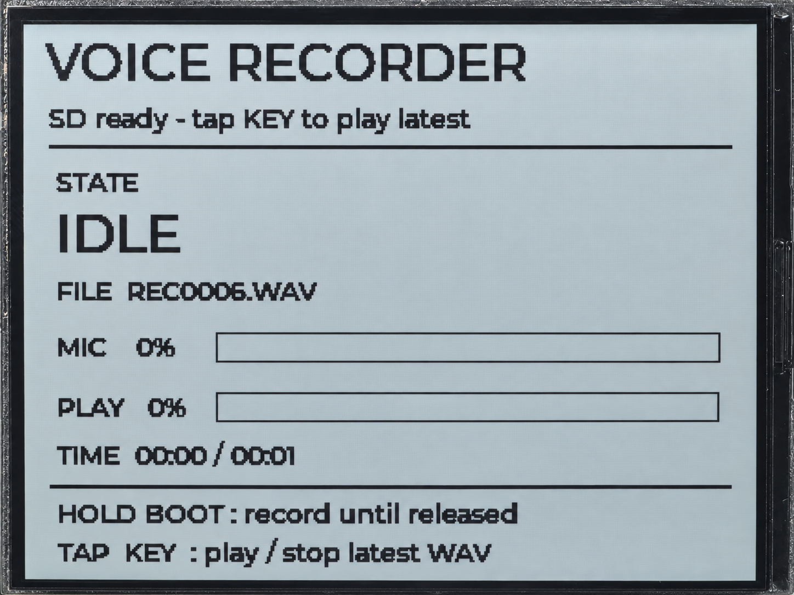

.. _arduino-audio:

11. MicroSD Audio Recording and Playback
========================================

Overview
--------

This lesson combines audio, a MicroSD card, and an LVGL interface into a voice
recorder. Hold the BOOT button to record and release it to save a WAV file.
Press the KEY button briefly to play or stop playback. The interface shows the
current state, filename, recording level indicator, and playback progress.

Recordings use 16 kHz, 16-bit, mono PCM, which stores sound as uncompressed digital
data. Files are saved in the card's ``/recordings`` directory with numbered names
such as ``REC0001.WAV``. This example records and plays back the recordings it creates.

Setup
-----

No code parameters need changing, but a memory card and an LVGL setup are required.

#. Install **LVGL 9.3.0** as described in :ref:`arduino-lvgl-ui`.
   For this lesson, use ``examples/arduino/11_audio/lv_conf.h`` and copy it
   to the Sketchbook's libraries directory, alongside the lvgl folder.
#. With power disconnected, insert a **FAT32 MicroSD card** and check that the speaker is connected correctly.
#. Download the code as described in :ref:`download-code`, then open
   ``examples/arduino/11_audio/11_audio.ino``. Keep the complete src directory.
   The required audio components are included in the example and do not need separate installation.
#. Check :ref:`arduino-board-settings`, confirm that OPI PSRAM is enabled, then compile and upload.
   Set the Serial Monitor to **115200** baud.

Operation and Expected Results
^^^^^^^^^^^^^^^^^^^^^^^^^^^^^^

After successful initialization, the speaker plays two short tones and the
interface enters IDLE. Use the following actions to record and play back audio:

.. list-table::
   :header-rows: 1
   :widths: 30 70

   * - Action
     - Function
   * - Hold the BOOT button
     - Recording starts after about 0.7 seconds; keep holding the button and speak
   * - Release the BOOT button
     - Stop recording and finish saving the WAV file
   * - Briefly press the KEY button while idle
     - Play the valid recording with the latest number
   * - Briefly press the KEY button during playback
     - Stop playback early
   * - Briefly press the KEY button in the ERROR state
     - Recheck MicroSD card and audio initialization

If no recordings are available, pressing KEY asks you to record first.
Holding BOOT during playback stops playback and starts a new recording.
The MIC bar responds to sound during recording; playback shows the progress
of data read and the time.

.. warning::
   After releasing BOOT, wait for the interface or serial output to confirm that
   the WAV file has been saved before disconnecting power and removing the card.
   Removing the card or power during recording may leave the file header incomplete.
   This example does not support memory card hot swapping.

Code Walkthrough
----------------

Processing Audio by State
^^^^^^^^^^^^^^^^^^^^^^^^^

The main program uses four states: IDLE, RECORDING, PLAYING, and ERROR.
Each main-loop iteration processes one block of audio data for the current state:

.. code-block:: cpp

   if (g_state == RecorderState::RECORDING) {
     recordStep();
   } else if (g_state == RecorderState::PLAYING) {
     playbackStep();
   } else {
     maybeCloseIdleCodec();
   }

Recording and playback are processed in blocks rather than loading a whole
recording into memory. Each main-loop iteration handles buttons, the MicroSD
card, and audio data in sequence, then updates the interface. If one step takes
longer, button handling must wait until it finishes.

Stereo Input and Mono Files
^^^^^^^^^^^^^^^^^^^^^^^^^^^

The ES7210 captures left and right microphone channels and sends the digital audio
to the main program over I2S. The main program averages the left and right values
to produce mono audio:

.. code-block:: cpp

   const int32_t mixed =
       ((int32_t)s_inputStereo[i * 2] + s_inputStereo[i * 2 + 1]) / 2;
   const int16_t mono = (int16_t)mixed;
   s_recordMono[i] = mono;

The values are promoted to 32 bits before addition to avoid overflow when adding
two 16-bit values. The WAV file stores mono data. When recording stops, the program
completes the header that describes the format and length. During playback,
each mono value is copied to both left and right channels and output through
the ES8311. The sample rate remains 16 kHz throughout this process.

Updating the Interface
^^^^^^^^^^^^^^^^^^^^^^

During recording and playback, interface data normally updates every 500 ms,
with immediate updates on state changes. The main loop calls ``lvglPortPoll()``
to handle LVGL timer updates and redrawing without an extra wait. The MIC bar
indicates recording signal strength, not ambient noise in decibels. Playback
progress is calculated from the amount of data read from the MicroSD card,
so it does not represent the exact position currently heard from the speaker.

Example Output
--------------

   Voice recorder interface in the idle state.

References
----------

* :ref:`arduino-sd-card`
* :ref:`arduino-lvgl-ui`
