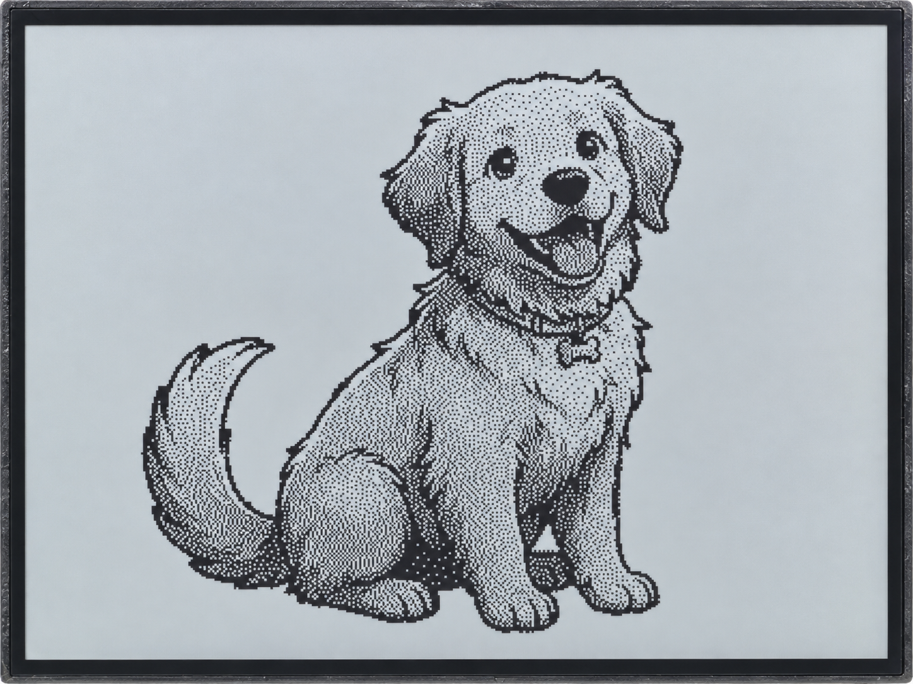

.. _arduino-photo-gallery:

12. Wi-Fi Photo Gallery
=======================

Overview
--------

This lesson lets the board create a Wi-Fi hotspot. Connect your phone, choose
a photo in the browser, adjust its black-and-white appearance, and upload it
to the RLCD. No router, Internet access, or phone app is required.

The web page supports photo previews, switching, deletion, and automatic slideshows.
With a MicroSD card inserted, you can save multiple photos. Without a card,
you can still upload a photo, but only one can be displayed temporarily and it
is lost after a restart. This example uses its included display driver; LVGL
and other third-party libraries are not required.

Setup
-----

No code parameters need changing if you use the default hotspot name and password.

#. To save photos, disconnect power and insert a **FAT32 MicroSD card**.
#. Complete :ref:`arduino-board-settings`, confirming **OPI PSRAM** and **16MB Flash**.
#. Download the code as described in :ref:`download-code`, then open
   ``examples/arduino/12_photo_gallery/12_photo_gallery.ino``, compile it, and upload it.
#. Open the Serial Monitor at **115200** baud to view hotspot details and device status.

To customize the hotspot, open ``examples/arduino/12_photo_gallery/gallery_config.h``
and change ``GALLERY_AP_SSID`` and ``GALLERY_AP_PASSWORD``, then recompile and upload.
Use at least 8 ASCII characters for the password; English letters and numbers are suitable.

Connecting and Uploading Photos
^^^^^^^^^^^^^^^^^^^^^^^^^^^^^^^

#. Connect your phone to **RLCD-Gallery** using the default password **12345678**.
   If the phone reports no Internet access, choose to stay connected.
#. Enter ``http://192.168.4.1/`` in the browser address bar to open the gallery page.
   If you changed the hotspot settings, use the details on the screen's help page or in the serial output.
#. Select a photo on your phone and view its converted black-and-white image in the preview area.
   Dithering (抖动（保留细节）) represents shades using patterns of black and white dots;
   binary conversion (二值（对比强烈）) reduces the image directly to black and white.
   Fill/crop (填充裁切) covers the screen, while fit with margins (完整留白) preserves
   the entire photo. You can also adjust brightness (亮度) and contrast (对比度).
#. Click **Upload and Display (上传并显示)** and wait for the success message. The new photo appears on the screen.
   Later, use the photo thumbnails on the web page to switch photos, or click Delete (删除) to remove one.

On the first startup with no valid photos, the screen shows a help page containing
the hotspot name, password, and address. In card mode, if valid photos exist,
the program attempts to restore the last selected photo. If the page does not
open on your phone, check that it is still connected to the board's hotspot.
Reconnect if necessary, then enter the address again.

Buttons and Automatic Slideshow
^^^^^^^^^^^^^^^^^^^^^^^^^^^^^^^

.. list-table::
   :header-rows: 1
   :widths: 30 70

   * - Action
     - Function
   * - Briefly press the BOOT button
     - Show the previous photo
   * - Briefly press the KEY button
     - Show the next photo
   * - Hold the KEY button for about 0.7 seconds
     - Show the help page and stop the automatic slideshow
   * - Set Slideshow (幻灯片) on the web page
     - Select manual switching (手动切换), or automatic switching every 10, 30, or 60 seconds (每 10 秒、每 30 秒、每 60 秒)

If photos are available while the help page is shown, briefly pressing BOOT or KEY
first returns to the current photo. Uploading, manually switching, or deleting
a photo stops the automatic slideshow; select a slideshow interval again if needed.
The board continues the slideshow at the selected interval after the web page
is closed. The setting must be selected again after a restart.

How Photos Are Stored
^^^^^^^^^^^^^^^^^^^^^

The program checks the memory card at startup. The web page and help page show the current mode:

* **MicroSD card mode**: Stores up to 24 photos in the card's ``/gallery13`` directory,
  with names such as ``P01.rlcd``. These are the photo data files used by this example;
  they remain after power is removed.
* **Temporary mode**: If no card is inserted or the card is unavailable, only one photo
  is kept in memory. A new upload replaces it, and it is lost after a restart or power loss.

If the gallery is full, delete photos through the web page before uploading more.
To switch from temporary mode to MicroSD card mode, disconnect power, check and
insert the card correctly, then restart. The temporary photo is not automatically saved to the card.

.. warning::
   Keep power connected while uploading and saving. Wait for the completion message
   before disconnecting power and removing the card. Always disconnect power before
   inserting or removing the card; this example does not detect a newly inserted card while running.

Code Walkthrough
----------------

The Phone Processes Photos; the Board Receives Data
^^^^^^^^^^^^^^^^^^^^^^^^^^^^^^^^^^^^^^^^^^^^^^^^^^^

The web script in ``examples/arduino/12_photo_gallery/gallery_image.h`` scales
photos to 400 × 300 and converts them to black-and-white pixels. The page preview
and upload use the same pixel data, so the board does not need to decode the original JPEG or PNG.

``examples/arduino/12_photo_gallery/gallery_app.cpp`` registers the upload endpoint:

.. code-block:: cpp

   server.on("/api/upload", HTTP_POST, finishUpload, receiveUpload);

``receiveUpload()`` receives the data; ``finishUpload()`` saves and displays the
photo after reception is complete. Both the web page and image-processing script
are included in the example and become available when you connect to the board's hotspot.

Validating Before Saving
^^^^^^^^^^^^^^^^^^^^^^^^

After reception, the program first checks that only one photo was uploaded
and that its data is complete:

.. code-block:: cpp

   uploadComplete = uploadFiles == 1 && galleryValidate(scratch, uploadBytes);

In ``examples/arduino/12_photo_gallery/gallery_packet.h``, ``galleryValidate()``
checks the data identifier, dimensions, length, and CRC to avoid treating incomplete
data as a photo. The 400 × 300 monochrome pixels require 15000 bytes. Including
the header that describes dimensions and other information, the full packet is 15016 bytes.

In MicroSD card mode, ``gallery_store.cpp`` writes a temporary file, reads it back
to check the contents, and saves it as the final photo only after validation.
Temporary mode updates only the photo in memory.

Sending Pixels to the Display
^^^^^^^^^^^^^^^^^^^^^^^^^^^^^

``showFrame()`` reads the monochrome pixels row by row and passes them to the display driver:

.. code-block:: cpp

   for (uint16_t y = 0; y < GALLERY_HEIGHT; ++y) {
     const uint8_t *row = activeFrame + y * (GALLERY_WIDTH / 8);
     for (uint16_t x = 0; x < GALLERY_WIDTH; ++x)
       panel.setPixel(x, y, (row[x / 8] & (0x80U >> (x & 7))) ? LCD_PIXEL_BLACK : LCD_PIXEL_WHITE);
   }

Each uploaded byte stores 8 pixels, with 1 for black and 0 for white.
``setPixel()`` arranges these pixels as required by the display driver, and the
screen is refreshed after drawing is complete. Network requests, buttons, and
the automatic slideshow are handled in sequence by the same main loop, so button
responses and slideshow changes may be delayed during an upload.

Example Output
--------------

   A black-and-white photo uploaded from a phone and displayed on the RLCD.

References
----------

* :ref:`arduino-wifi-modes`
* :ref:`arduino-rlcd-driver`
* :ref:`arduino-sd-card`
