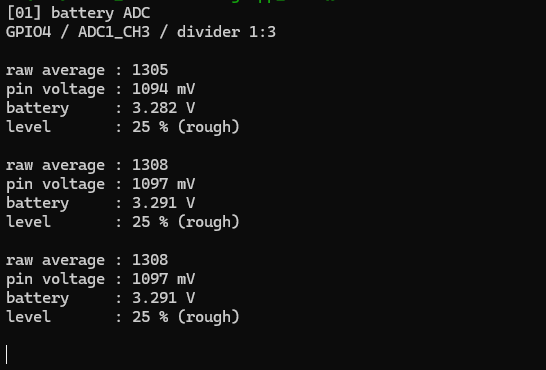

.. _idf-adc-battery:

1. ADC Battery Voltage Measurement
==================================

Overview
--------

This lesson uses the ADC to read the battery-monitoring pin and print the raw reading,
pin voltage, battery voltage, and estimated battery percentage to the serial console.
The ADC converts the voltage at a pin into a numerical value.

The program uses the ADC driver and calibration support included with ESP-IDF.
Each cycle takes 16 readings and calculates their averages.
This example does not drive the RLCD. After flashing, use the serial console to view the results;
the screen may still show the previous image.

Setup
-----

No code settings need to be changed, and no additional third-party components are required.

* Follow :ref:`esp-idf-tutorial` to set up the environment and download the example code.
* Correctly connect a compatible 18650 battery, then connect the board to your computer
  with a USB Type-C data cable. Keep USB connected while the example runs.
* Open the ``examples/esp-idf/01_adc_battery`` project directory.
  Follow :ref:`idf-build-flash` to build, flash, and open the serial monitor.
* You can use a multimeter to compare the voltage readings.

.. warning::
   Battery monitoring uses the onboard voltage-divider circuit, so no extra wiring is needed.
   Disconnect power before connecting or removing the battery, and check the battery connector polarity.

Code Walkthrough
----------------

Initializing the ADC and Calibration
^^^^^^^^^^^^^^^^^^^^^^^^^^^^^^^^^^^^

The program entry point is ``examples/esp-idf/01_adc_battery/main/app_main.c``.
It calls ``board_battery_init()`` to initialize the ADC, then repeatedly reads and prints the results.
``ESP_ERROR_CHECK()`` checks the initialization result; if initialization fails, it reports the error and aborts the program.

The reading logic is in ``examples/esp-idf/components/board_bsp/board_adc.c``.
Battery monitoring uses GPIO4, which is ADC1 channel 3. The reading resolution and input range are configured as follows:

.. code-block:: c

   const adc_oneshot_chan_cfg_t channel_config = {
       .atten = ADC_ATTEN_DB_12,
       .bitwidth = ADC_BITWIDTH_12,
   };

The 12-bit raw reading is in the range 0–4095. ``ADC_ATTEN_DB_12`` adjusts the ADC input range;
this is separate from the onboard resistors that reduce the battery voltage to one third.
Initialization also sets up calibration to convert raw readings into pin voltage.

Reading and Converting Battery Voltage
^^^^^^^^^^^^^^^^^^^^^^^^^^^^^^^^^^^^^^

Each call to ``adc_oneshot_read()`` obtains a raw reading.
``adc_cali_raw_to_voltage()`` then converts that same reading into a calibrated value in millivolts.
The main program passes a sample count of 16 to ``board_battery_read()``,
which calculates separate averages for the raw readings and millivolt values.

The battery terminal voltage is then calculated:

.. code-block:: c

   sample->battery_voltage = sample->pin_millivolts / 1000.0f *
                             BOARD_BATTERY_DIVIDER_RATIO;
   sample->estimated_percent = estimate_percent(sample->battery_voltage);

The program first divides by 1000 to convert millivolts to volts, then multiplies by the
onboard divider ratio. ``BOARD_BATTERY_DIVIDER_RATIO`` is 3.
For example, an average pin voltage of 1261 mV gives a battery voltage of 3.783 V.

Battery percentage is estimated from voltage: 3.00 V or below is shown as 0%, and 4.12 V or above as 100%,
with proportional values in between. Load, temperature, and charging state all affect voltage.
These two values are used only to calculate the displayed percentage; they are not thresholds for battery protection.

Setting the Reading Interval
^^^^^^^^^^^^^^^^^^^^^^^^^^^^

The main program waits one second after printing each set of readings:

.. code-block:: c

   vTaskDelay(pdMS_TO_TICKS(PRINT_INTERVAL_MS));

``PRINT_INTERVAL_MS`` is set to 1000. ``pdMS_TO_TICKS()`` converts milliseconds into system ticks.
``vTaskDelay()`` pauses the current task so the system can run other tasks while it waits.
``app_main()`` already runs in a FreeRTOS task, so this example does not need a separate sampling task.
Sampling and printing also take time, making the interval between outputs slightly longer than one second.

Example Output
--------------

The serial monitor shows output similar to the following. These numbers illustrate the format;
they are not measured results from the IDF version:

.. code-block:: text

   [01] battery ADC
   GPIO4 / ADC1_CH3 / divider 1:3

   raw average : 1684
   pin voltage : 1261 mV
   battery     : 3.783 V
   level       : 69 % (rough)

.. list-table::
   :header-rows: 1
   :widths: 25 75

   * - Output
     - Meaning
   * - raw average
     - Average raw ADC reading, with no voltage unit
   * - pin voltage
     - Average voltage at GPIO4, in millivolts
   * - battery
     - Battery terminal voltage calculated using the divider ratio, in volts
   * - level
     - Approximate battery percentage estimated from voltage

The measurement comes from the battery-monitoring circuit. Readings taken without a battery connected
do not represent actual battery charge. If a read fails, the program prints ``ADC read failed:``
with the error name and skips the normal readings for that cycle.
The current implementation also treats an average pin voltage of zero as a read failure.
Check the battery connection and board model, then use the error name to investigate.

   Serial output from battery voltage monitoring. Actual values vary with battery condition.

References
----------

* `ESP-IDF 5.4: ADC Oneshot Mode Driver <https://docs.espressif.com/projects/esp-idf/en/v5.4/esp32s3/api-reference/peripherals/adc_oneshot.html>`_
* `ESP-IDF 5.4: ADC Calibration Driver <https://docs.espressif.com/projects/esp-idf/en/v5.4/esp32s3/api-reference/peripherals/adc_calibration.html>`_
