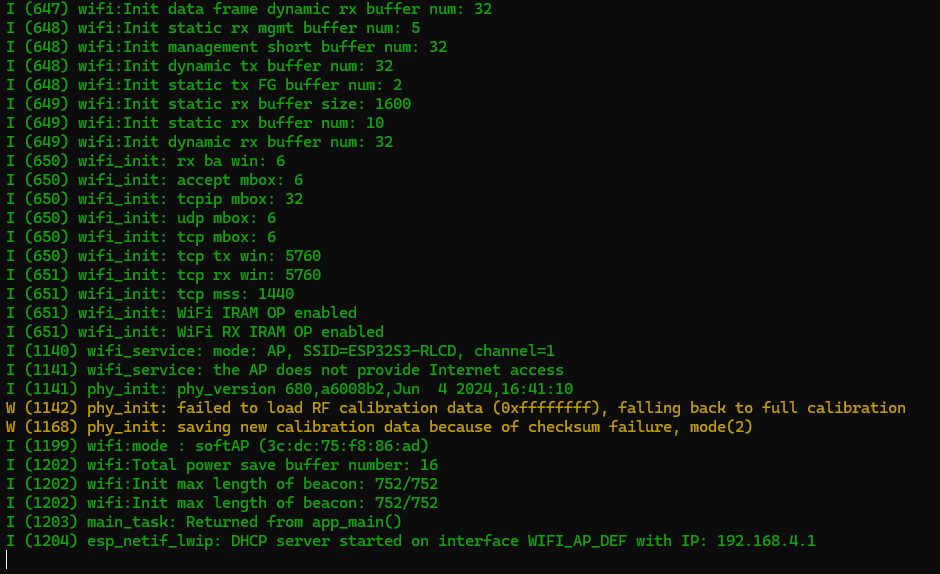

.. _idf-wifi-modes:

2. Wi-Fi STA and AP Modes
=========================

Overview
--------

This lesson introduces the board's Wi-Fi features through two operating modes:

* **AP mode**: The board creates a hotspot for a phone or computer and reports the number of connected devices.
* **STA mode**: The board connects to an existing wireless router and reports signal strength and its MAC address after obtaining an IP address.

The example defaults to AP mode and runs one mode at a time. Results are shown in the serial console.
This example does not drive the RLCD or provide a web service.

Setup
-----

Follow :ref:`esp-idf-tutorial` to prepare the environment and download the code,
then open the ``examples/esp-idf/02_wifi_modes`` project directory.
Set the mode and network parameters in ``examples/esp-idf/02_wifi_modes/main/app_config.h``.
There is no need to use menuconfig. Rebuild and flash after changing these settings.

AP: Creating a Local Hotspot
^^^^^^^^^^^^^^^^^^^^^^^^^^^^

``APP_WIFI_MODE`` defaults to ``APP_WIFI_MODE_AP``, so you can run this mode without changes.
The hotspot parameters are:

.. code-block:: c

   #define APP_WIFI_AP_SSID            "ESP32S3-RLCD"
   #define APP_WIFI_AP_PASSWORD        "12345678"
   #define APP_WIFI_AP_CHANNEL         1
   #define APP_WIFI_AP_MAX_CONNECTIONS  4

These four settings specify the hotspot name, password, channel, and maximum number of connections.
Keep the double quotes when changing the name or password. Use 8–63 characters for the password.

#. Follow :ref:`idf-build-flash` to build, flash, and open the serial monitor.
#. On your phone or computer, connect to **ESP32S3-RLCD** with the password **12345678**.
   If you changed the settings, use your new name and password.
#. Look for ``station joined``, ``station left``, and ``connected devices`` in the serial console.
   These indicate a device joining, a device leaving, and the current connection count.

.. note::
   A "No Internet access" message on your phone is normal. Choose to stay connected.
   This hotspot provides a local connection only and does not forward Internet traffic.
   You do not need to open the hotspot address in a browser.

STA: Connecting to a Router
^^^^^^^^^^^^^^^^^^^^^^^^^^^

Prepare a **2.4 GHz Wi-Fi network using WPA2 or stronger security**.
This example does not connect to open hotspots without a password.
Change ``APP_WIFI_MODE`` to ``APP_WIFI_MODE_STA``, then enter the network name and password:

.. code-block:: c

   #define APP_WIFI_SSID       ""
   #define APP_WIFI_PASSWORD   ""

Replace the empty strings with your network details, keeping the double quotes.
These are the settings for your router or phone hotspot; they are separate from the board's AP hotspot settings.
Remove real Wi-Fi passwords before sharing code or screenshots.

Rebuild and flash, then check the connection results in the serial console:

* ``connected, IP=...`` means an IP address has been obtained.
* ``online, RSSI=... dBm`` shows the current signal strength. It is printed about every five seconds while connected, followed by the MAC address.
* ``STA SSID is empty`` means the network name is missing. Complete the settings and flash again.
* ``connection timeout`` means this connection attempt timed out. Check the name, password, and network availability.

Code Walkthrough
----------------

Starting Wi-Fi from the Configuration
^^^^^^^^^^^^^^^^^^^^^^^^^^^^^^^^^^^^^

``examples/esp-idf/02_wifi_modes/main/app_main.c`` prepares AP or STA parameters
according to ``APP_WIFI_MODE``, then starts the shared Wi-Fi service:

.. code-block:: c

   ESP_ERROR_CHECK(wifi_service_start(&config));

The implementation is in ``examples/esp-idf/components/wifi_service/wifi_service.c``.
A successful return means the service has started. STA network readiness still depends on receiving an IP address event.
The Wi-Fi service continues running after ``app_main()`` returns.

Reporting Connection Results with Events
^^^^^^^^^^^^^^^^^^^^^^^^^^^^^^^^^^^^^^^^

The Wi-Fi driver notifies the program when a device joins the hotspot, STA disconnects, or an IP address is obtained.
For example, after obtaining an IP address, the program clears the disconnected state and marks the network as ready:

.. code-block:: c

   xEventGroupClearBits(s_sta_events, STA_DISCONNECTED_BIT);
   xEventGroupSetBits(s_sta_events, STA_GOT_IP_BIT);

These states act as flags for the connection task. The event handler updates them,
while the connection task waits for results and retries as needed.
The AP device count is also read and printed when a device joins or leaves.

Connection Timeouts and Retries
^^^^^^^^^^^^^^^^^^^^^^^^^^^^^^^

Two settings in the configuration file control the waiting times:

.. code-block:: c

   #define APP_WIFI_CONNECT_TIMEOUT_MS 10000U
   #define APP_WIFI_RETRY_INTERVAL_MS  15000U

By default, each attempt waits up to 10 seconds for an IP address. After a failed attempt or a disconnection,
the connection task waits another 15 seconds before trying again.
A separate task handles these waits, so ``app_main()`` does not need to keep checking the connection.

Example Output
--------------

The image below shows the startup log in the default AP mode, including the hotspot name, channel, and IP address.
``Returned from app_main()`` means the entry function has finished; the system still handles subsequent Wi-Fi events.
Timestamps, MAC addresses, and other details will depend on your own run.

   Serial output after AP mode creates the ESP32S3-RLCD hotspot.

References
----------

* `ESP-IDF 5.4: Wi-Fi API <https://docs.espressif.com/projects/esp-idf/en/v5.4/esp32s3/api-reference/network/esp_wifi.html>`_
