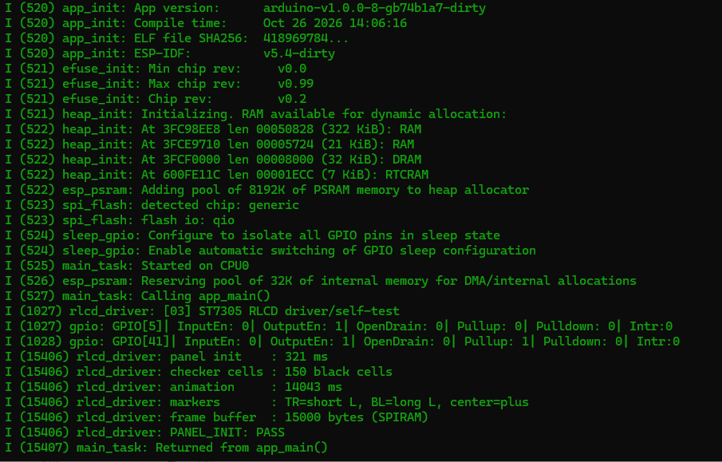

.. _idf-rlcd-driver:

3. RLCD Driver and Display Self-Test
====================================

Overview
--------

This lesson uses the included ST7305 driver to control the reflective LCD.
You will learn how to start the display, draw pixels, and update a complete frame.
The program draws a checkerboard one cell at a time, then shows orientation markers to help you check the image direction and edges.

This example uses a 400 × 300 landscape layout and requires no third-party display library.

Setup
-----

No code settings need to be changed. Follow :ref:`esp-idf-tutorial` to prepare the environment and download the code,
then open the ``examples/esp-idf/03_rlcd_driver`` project directory.
Check :ref:`idf-board-settings`, especially that **OPI PSRAM** is enabled,
then follow :ref:`idf-build-flash` to build, flash, and open the serial monitor.

After startup, the screen is cleared to white, then black checkerboard cells appear one by one in row order.
After completing the checkerboard, the program clears the screen to white again and displays a short L at the top right,
a long L at the bottom left, and a cross in the center. The different L lengths help identify an upside-down image.
The sequence runs once. Reset the board to see it again.

Code Walkthrough
----------------

Preparing the Frame in Memory
^^^^^^^^^^^^^^^^^^^^^^^^^^^^^

The program first prepares a complete image in memory, in an area called the frame buffer.
``examples/esp-idf/components/board_display/board_display.c`` allocates PSRAM for it:

.. code-block:: c

   s_display.frame_buffer = heap_caps_malloc(
       s_display.frame_buffer_size, MALLOC_CAP_SPIRAM | MALLOC_CAP_8BIT);

Each monochrome pixel uses 1 bit, so 400 × 300 pixels require 15000 bytes.
This driver stores the frame in PSRAM, so keep the project's default PSRAM configuration.
Initialization also resets the display, writes its startup settings, and clears the in-memory image to white.

Sending the Complete Frame
^^^^^^^^^^^^^^^^^^^^^^^^^^

``examples/esp-idf/03_rlcd_driver/main/app_main.c`` calls
``board_display_set_pixel()`` to change pixels in memory,
then uses ``board_display_flush()`` to send the complete frame to the display.
The driver's transfer call is:

.. code-block:: c

   err = esp_lcd_panel_io_tx_color(
       s_display.io, 0x2C,
       s_display.frame_buffer, s_display.frame_buffer_size);

Only one black checkerboard cell is added at a time, but every transfer still sends the complete frame.
After submitting the data, the current IDF driver waits for the transfer to finish.
When ``board_display_flush()`` returns successfully, that SPI transfer is complete.

Finding Pixels from Coordinates
^^^^^^^^^^^^^^^^^^^^^^^^^^^^^^^

The ST7305 stores pixels in a different order from a conventional row-by-row image.
The driver finds the byte and bit for each pixel; drawing code only needs to supply coordinates starting from the top-left corner.
This example uses 0 for white and 1 for black. Display orientation settings and coordinate calculations must be changed together.

Example Output
--------------

The serial console reports initialization time, black cell count, animation time, and frame buffer size.
The default layout contains **150 black cells**, and the frame uses **15000 bytes**.
Animation time includes full-frame transfers and the 80 ms wait after each cell, as well as pixel calculations.

``PANEL_INIT: PASS`` means the program completed initialization, the checkerboard animation, and the final frame transfer.
Check the actual screen to confirm that the orientation and edges are correct.

   Serial output after the display driver self-test. Timing values depend on the actual run.

References
----------

* `ESP-IDF 5.4: SPI LCD Interface <https://docs.espressif.com/projects/esp-idf/en/v5.4/esp32s3/api-reference/peripherals/lcd/spi_lcd.html>`_
