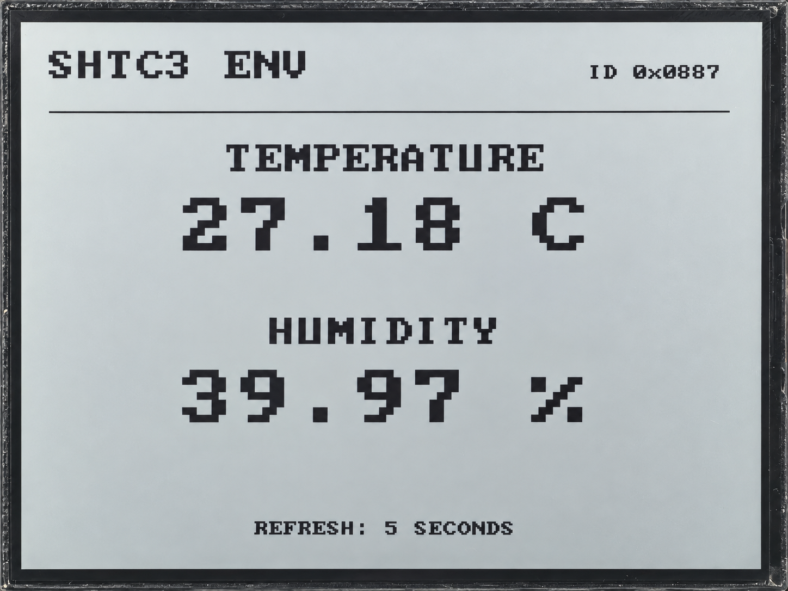

.. _idf-shtc3:

6. Temperature and Humidity Measurement
=======================================

Overview
--------

This lesson reads the onboard SHTC3 temperature and humidity sensor immediately after startup,
then updates the readings every five seconds in both the serial console and on the RLCD.
The program checks the CRC values supplied by the sensor to detect transmission errors.

Setup
-----

No code settings need to be changed, and no additional third-party components are required.
Follow :ref:`esp-idf-tutorial` to prepare the environment and the complete example code,
then open the ``examples/esp-idf/06_shtc3_env`` project.
Follow :ref:`idf-build-flash` to build, flash, and open the serial monitor.
This example uses the onboard sensor, so no external sensor or network connection is needed.

Code Walkthrough
----------------

Waking and Reading the Sensor
^^^^^^^^^^^^^^^^^^^^^^^^^^^^^

``examples/esp-idf/components/shtc3/shtc3.c`` sends a wake command, waits 1 ms,
then starts a measurement. After waiting 15 ms, it reads six bytes: two for temperature,
two for humidity, and one CRC byte for each reading. After reading, it attempts to put the sensor back to sleep.

Temperature and humidity are checked separately and converted only after both checks pass:

.. code-block:: c

   if (crc8(&response[0], 2) != response[2] ||
       crc8(&response[3], 2) != response[5]) {
       return ESP_ERR_INVALID_CRC;
   }

Checking and Converting the Readings
^^^^^^^^^^^^^^^^^^^^^^^^^^^^^^^^^^^^

The two raw values are converted into degrees Celsius and relative humidity using the datasheet formulas:

.. code-block:: c

   sample->temperature_c =
       -45.0f + 175.0f * (float)raw_temperature / 65536.0f;
   sample->humidity_percent =
       100.0f * (float)raw_humidity / 65536.0f;

``examples/esp-idf/06_shtc3_env/main/app_main.c`` manages the measurement interval and display.
It uses ``vTaskDelayUntil()`` to schedule each cycle from the previous planned time,
reducing timing drift caused by measurement and drawing.

Displaying the Chip ID and Measurements
^^^^^^^^^^^^^^^^^^^^^^^^^^^^^^^^^^^^^^^

The program also reads the chip ID at startup. After a successful read and CRC check,
it shows the ID at the top right of the screen; this step does not check the product code within the ID.
If the ID read fails, the program logs a warning and still attempts temperature and humidity measurements.
If a measurement, data check, or sleep command fails, that cycle shows an error instead of normal readings.

Example Output
--------------

The screen shows temperature, relative humidity, and a five-second refresh notice.
The serial console also prints the temperature and humidity.
If a measurement fails, the screen shows ``MEASURE FAILED`` with ``ERROR: CRC`` or ``ERROR: I2C``
to distinguish a checksum error from other read errors. Check the serial log for the specific cause.
Use your actual output for the temperature, humidity, and chip ID.

   SHTC3 temperature, humidity, and chip ID display.

References
----------

* `Sensirion SHTC3 Datasheet <https://sensirion.com/media/documents/643F9C8E/63A5A436/Datasheet_SHTC3.pdf>`_
