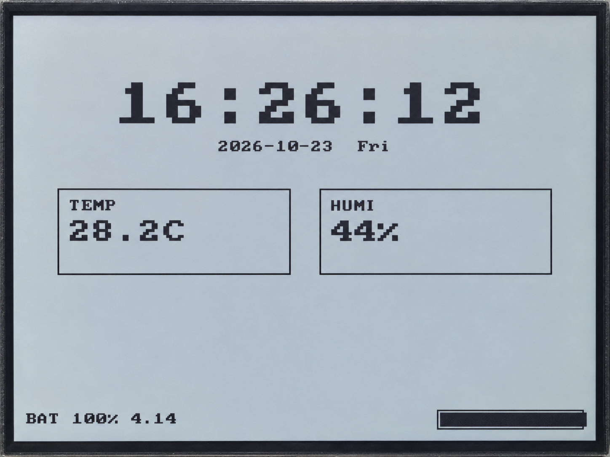

.. _idf-local-dashboard:

7. Local Dashboard
==================

Overview
--------

This lesson combines the RTC, SHTC3, battery monitoring, and buttons into a two-page dashboard.
The overview page shows the clock, temperature, humidity, and battery information.
The details page shows additional data plus drawing and transfer times.
Timers, buttons, and serial commands send work requests to the application, which reads data and updates the pages in sequence.

Setup
-----

No code settings need to be changed. No network connection or additional third-party components are required.
Follow :ref:`esp-idf-tutorial` to prepare the environment and the complete example code,
then open the ``examples/esp-idf/07_local_dashboard`` project.
Follow :ref:`idf-build-flash` to build, flash, and open the serial monitor.
To display the actual battery voltage, correctly connect a compatible battery. Disconnect power before connecting or removing it.

Operation and Controls
^^^^^^^^^^^^^^^^^^^^^^

The screen first shows the overview page. Use the buttons as follows:

.. list-table::
   :header-rows: 1
   :widths: 25 75

   * - Action
     - Function
   * - Press the KEY button
     - Switch between the overview and details pages
   * - Press the BOOT button
     - Redraw the current page using the stored readings, without taking new sensor readings

If the time is unreliable, wait for the ``dashboard>`` prompt in the serial console,
enter ``rtc-set YYYY-MM-DD HH:MM:SS``, and press Enter. See :ref:`idf-rtc` for the format.
Wait for ``RTC set OK ->`` to confirm success. If you see ``Dashboard is busy; try again``, retry later.
Failed temperature, humidity, or battery reads are shown as placeholders. Battery percentage remains a rough voltage-based estimate.

Code Walkthrough
----------------

Scheduling Work with Events
^^^^^^^^^^^^^^^^^^^^^^^^^^^

``examples/esp-idf/07_local_dashboard/main/app_main.c`` creates an event queue,
which is a list of pending work. Timers, buttons, and the serial console only post events.
The application waits for these events, then handles sensor reads and page drawing:

.. code-block:: c

   if (xQueueReceive(s_event_queue, &event, portMAX_DELAY) != pdTRUE) {
       continue;
   }

``portMAX_DELAY`` makes the application wait for an event instead of repeatedly checking while idle.
One task maintains the application's time, sensor data, and page state, avoiding simultaneous display access by multiple tasks.

Setting Separate Reading Intervals
^^^^^^^^^^^^^^^^^^^^^^^^^^^^^^^^^^

The following settings control the two timer intervals and the number of battery samples per read:

.. code-block:: c

   #define FAST_REFRESH_MS 1000
   #define ENVIRONMENT_REFRESH_MS 10000
   #define BATTERY_SAMPLE_COUNT 16

The one-second event reads the time and battery, while the ten-second event measures temperature and humidity.
Results are stored in variables for the pages to use.
The data continues to update on the details page, but the page does not redraw after each one-second time and battery read.
Temperature and humidity updates, page changes, the BOOT button, or time setting trigger a redraw.

Measuring Drawing and Transfer Time
^^^^^^^^^^^^^^^^^^^^^^^^^^^^^^^^^^^

After drawing the page, the program calls the display refresh function and records the time it takes:

.. code-block:: c

   const esp_err_t err = board_display_flush();
   state->last_flush_ms =
       (uint32_t)((esp_timer_get_time() - started_at) / 1000);

``draw`` measures drawing in memory, while ``flush`` includes the wait for SPI transfer completion.
The ``last draw`` and ``last flush`` fields on the details page show the previous refresh statistics.
This example reuses the shared display driver and does not include the Arduino version's pixel lookup-table comparison test.

Example Output
--------------

The overview page shows the time, date, temperature, humidity, and battery information.
Press the KEY button to view details and timing statistics.
The serial console prints ``refresh: draw=... ms, flush=... ms``, with actual measurements in place of the ellipses.
If the RTC reports that its clock has stopped, ``RTC TIME UNRELIABLE`` appears and you need to set the time again.

   Overview page of the local dashboard.

References
----------

* :ref:`idf-rtc`
* :ref:`idf-shtc3`
* :ref:`idf-adc-battery`
