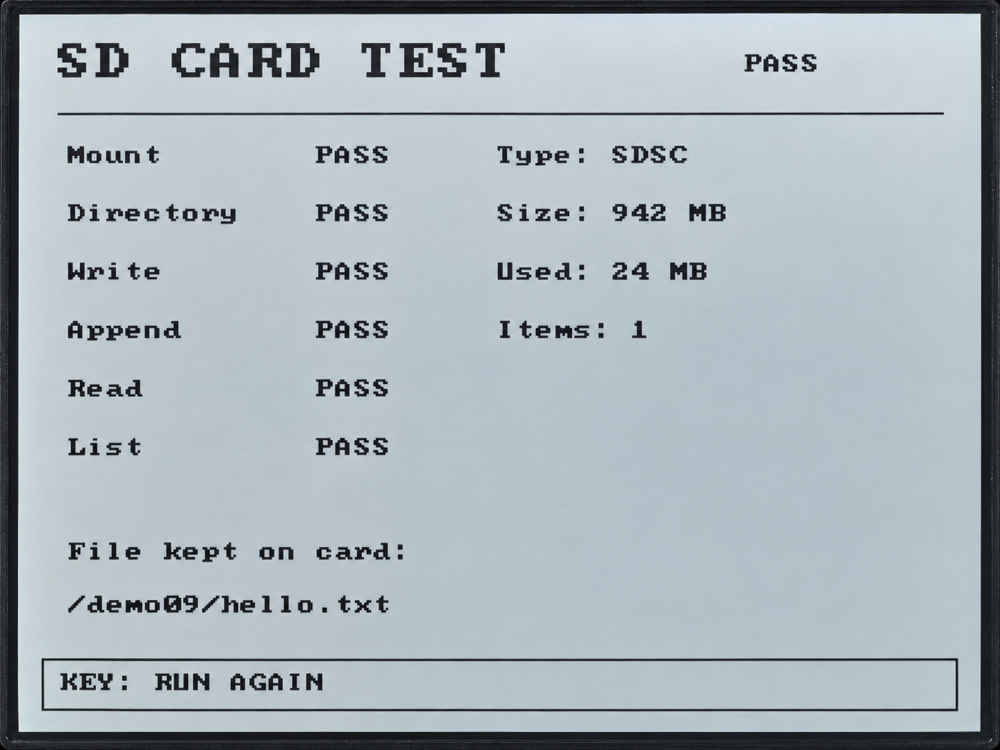

.. _idf-sd-card:

9. Reading and Writing a MicroSD Card
=====================================

Overview
--------

This lesson uses the onboard MicroSD card slot to read card information, create a directory,
write and append text, read the file back to check its contents, and list directory entries.
Results appear on both the RLCD and serial console. Press the KEY button to run the test again.

Setup
-----

No code settings need to be changed, and no additional third-party components are required.
Follow :ref:`esp-idf-tutorial` to prepare the environment and download the complete code.
With power disconnected, insert a **FAT32 MicroSD card**, then connect a USB Type-C data cable.
Open the ``examples/esp-idf/09_sd_card`` project and follow :ref:`idf-build-flash` to build, flash, and view the output.

.. warning::
   Each run overwrites /demo09/hello.txt on the card, then appends the test text.
   Back up the file first if it contains anything you want to keep.
   The program does not automatically format the card. Disconnect power before inserting or removing it.

Operation and Controls
^^^^^^^^^^^^^^^^^^^^^^

After startup, the program identifies the card, creates a directory, writes text, appends text,
checks the file contents, and lists the directory, in that order.
When all six checks pass, ``PASS`` appears at the top right of the screen and the console prints ``[09] result: PASS``.
Card type, capacity, and used space depend on the actual card.

Press the KEY button to run the test again. When it finishes, /demo09/hello.txt remains on the card with the following contents:

.. code-block:: text

   Hello from ESP32-S3 RLCD!
   Append test passed.

If no card is inserted or card detection fails, disconnect power, check and reinsert the card, then restart.
This example does not detect card insertion or removal while running.

Code Walkthrough
----------------

Mounting and Accessing the MicroSD Card
^^^^^^^^^^^^^^^^^^^^^^^^^^^^^^^^^^^^^^^

``examples/esp-idf/components/board_sdcard/board_sdcard.c`` uses SDMMC 1-bit mode
to access the card through the CLK, CMD, and D0 signal lines. Automatic formatting on mount failure is disabled.
Initialization ultimately calls:

.. code-block:: c

   esp_err_t err = esp_vfs_fat_sdmmc_mount(
       config->mount_path, &host, &slot, &mount_config, &s_card);

The default mount point is /sdcard. The full file path in the program is /sdcard/demo09/hello.txt.
Here, /sdcard is the system prefix for accessing the card; the directory on the card is still /demo09.
The screen therefore shows the shorter path within the card.

Writing and Appending
^^^^^^^^^^^^^^^^^^^^^

``examples/esp-idf/09_sd_card/main/app_main.c`` overwrites the file, then appends the second line of text:

.. code-block:: c

   result.write_ok = write_text(DEMO_FILE, "wb", FIRST_TEXT);
   if (result.write_ok) {
       result.append_ok = write_text(DEMO_FILE, "ab", APPEND_TEXT);
   }

``write_text()`` uses standard C file functions. ``wb`` clears the old contents before writing,
while ``ab`` appends at the end of the file. The program checks the number of bytes written and the file-close result.

Reading Back and Checking the Contents
^^^^^^^^^^^^^^^^^^^^^^^^^^^^^^^^^^^^^^

After reading the complete file, the program compares the result with the expected text:

.. code-block:: c

   result.read_ok = strcmp(read_back, EXPECTED_TEXT) == 0;

The button service only places KEY button events in a queue. The main program runs the test after receiving an event.
One application task handles file operations and display updates in sequence, preventing two tests from running at the same time.

Example Output
--------------

   MicroSD card read and write test results, with the test file's path on the card.

References
----------

* :ref:`idf-project-structure`
* :ref:`idf-rlcd-driver`
