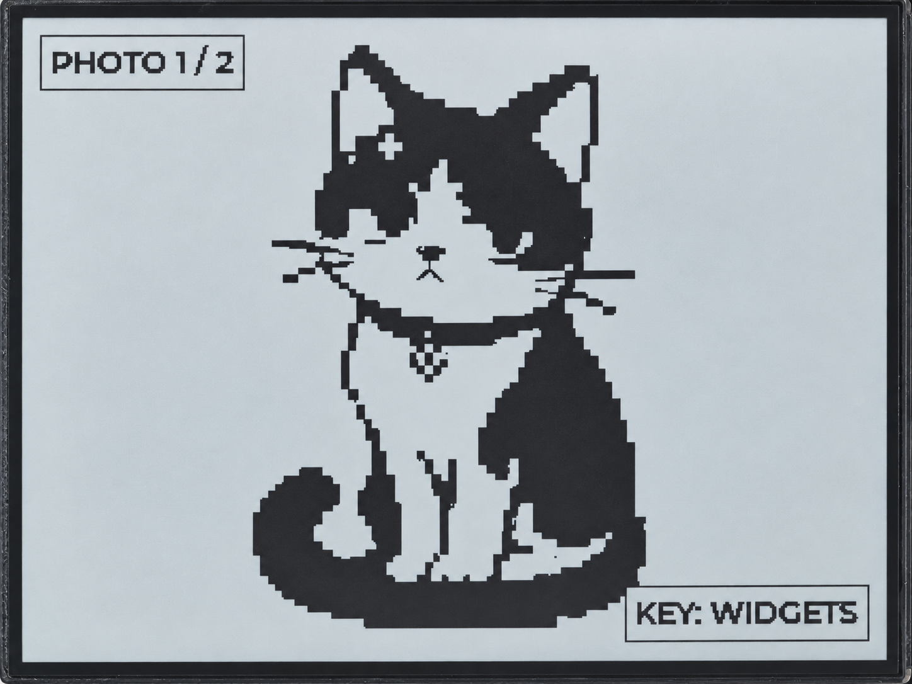

.. _idf-lvgl-ui:

10. LVGL Interface and Photo Display
====================================

Overview
--------

This lesson uses LVGL 9 to create two pages. The first shows text, a button, checkbox, switch, slider, and progress bar.
The second cycles through two built-in photos. Use the KEY button to switch pages.

The board has no touchscreen; the program changes the widget states automatically.
The photos are included in the project resources, so no MicroSD card or network connection is needed to load them.

Setup
-----

No application settings need to be changed. Follow :ref:`esp-idf-tutorial` to download the complete code,
open the ``examples/esp-idf/10_lvgl_ui`` project, and check :ref:`idf-board-settings`.
Then follow :ref:`idf-build-flash` to build, flash, and view the serial output.

The project pins **LVGL 9.3.0** in main/idf_component.yml.
The first build requires Internet access to download the component.
LVGL settings come from the shared sdkconfig.lvgl.defaults file; you do not need to copy the Arduino lv_conf.h file.
Keep the included resources and partitions.csv. The partition file provides a 4 MB application partition;
the board's Flash size remains 16 MB.

Operation and Controls
^^^^^^^^^^^^^^^^^^^^^^

The widget page is shown at startup. The slider and progress bar change value every second.
At 50% or above, the checkbox and switch appear selected.

Press the KEY button to open the photo page. Every three seconds, the program checks whether the photo page is active;
if it is, it switches to the other photo. Press the KEY button again to return to the widget page.
The current photo is retained when changing pages, and photos do not continue cycling while the photo page is hidden.
The serial console prints the page number after each change.

Code Walkthrough
----------------

Adding Text to a Button
^^^^^^^^^^^^^^^^^^^^^^^

After creating a button, ``examples/esp-idf/10_lvgl_ui/main/ui.c`` adds text inside it:

.. code-block:: c

   lv_obj_t *text = lv_label_create(button);
   lv_label_set_text(text, "BUTTON");
   lv_obj_center(text);

The widgets for both pages are created only at startup. Page changes hide or show the corresponding page.
Separate timers schedule widget changes and photo switching:

.. code-block:: c

   lv_timer_create(widget_timer, 1000, NULL);
   lv_timer_create(photo_timer, 3000, NULL);

Running the Display in a Separate Task
^^^^^^^^^^^^^^^^^^^^^^^^^^^^^^^^^^^^^^

``examples/esp-idf/components/rlcd_lvgl_port/rlcd_lvgl_port.c`` creates a separate LVGL task
to run timers, draw, and refresh the display. The button service only sends page-change requests.
When ``examples/esp-idf/10_lvgl_ui/main/app_main.c`` receives a request,
it locks LVGL before changing the page and unlocks it afterward:

.. code-block:: c

   rlcd_lvgl_port_lock(UINT32_MAX);
   demo_ui_next_page();
   rlcd_lvgl_port_unlock();

This lock coordinates access to LVGL between page changes and the display task, preventing simultaneous changes to UI objects.

Output to the Monochrome Screen
^^^^^^^^^^^^^^^^^^^^^^^^^^^^^^^

The display port uses I1 format, with 1 bit per monochrome pixel.
The 400 × 300 pixels require 15000 bytes, plus 8 bytes at the beginning for the two-color palette,
for a total PSRAM drawing buffer of 15008 bytes.

During a refresh, the port skips those 8 bytes, converts the pixel layout and black/white bit values,
then passes the result to the display driver. The IDF driver waits for SPI transfer completion before returning successfully.

Example Output
--------------

.. figure:: ../img/idf/10-1_phen.png
   :alt: ESP-IDF LVGL automatic widget demonstration page
   :width: 800px
   :align: center

   LVGL widget page, with values and selection states updated automatically by the program.

   Press the KEY button to open the photo page, which cycles through two built-in photos.

References
----------

* :ref:`idf-rlcd-driver`
* :ref:`idf-hello-rlcd`
