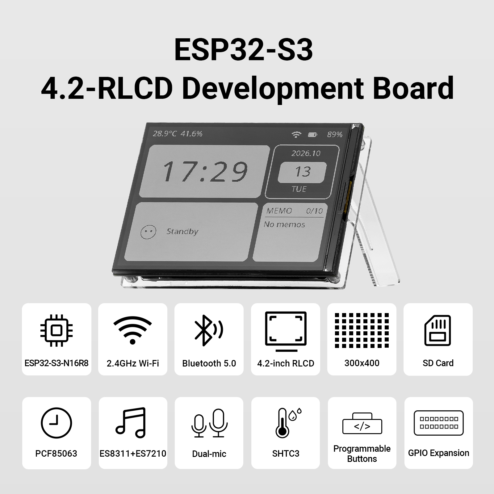
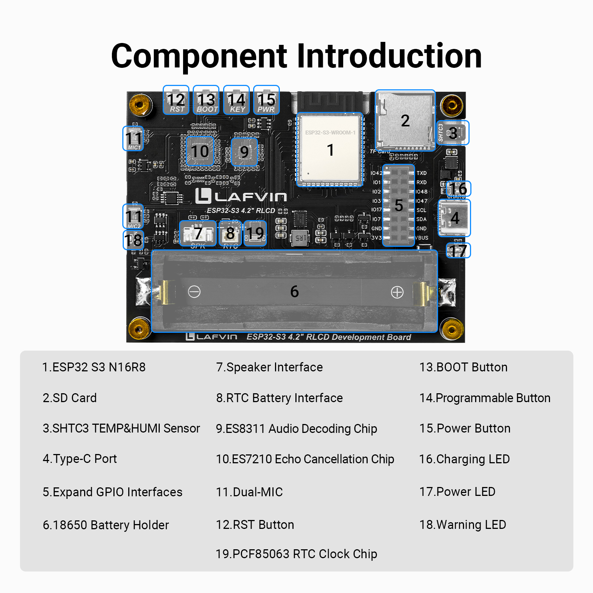
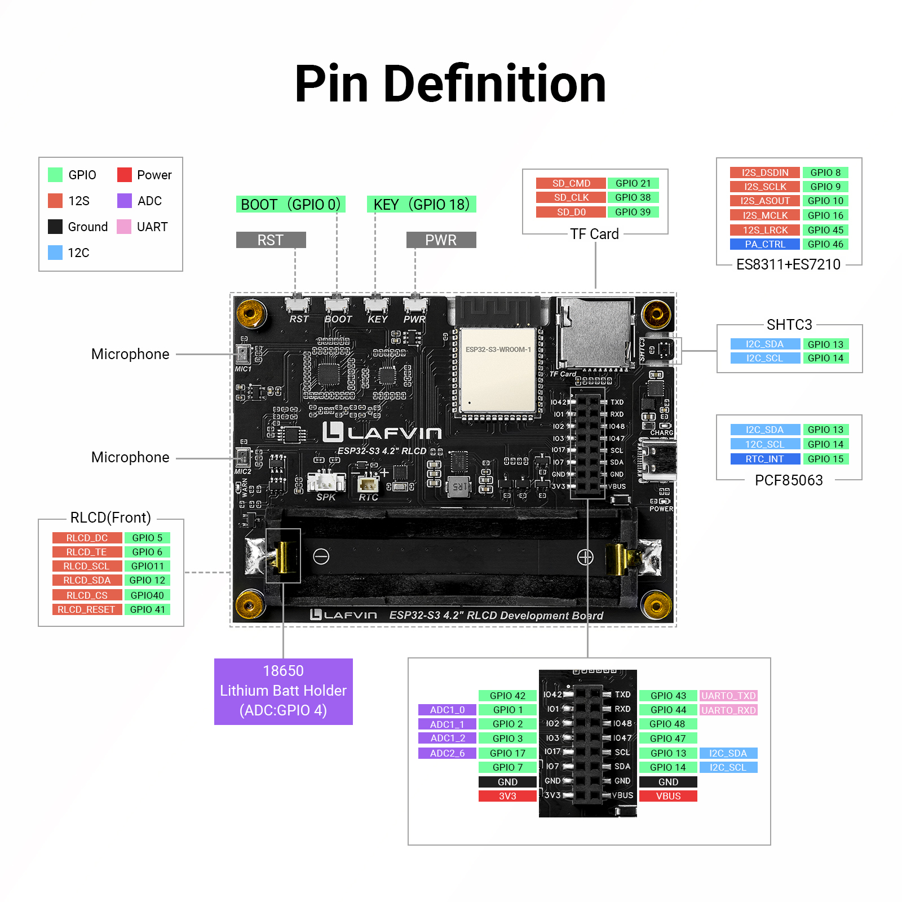
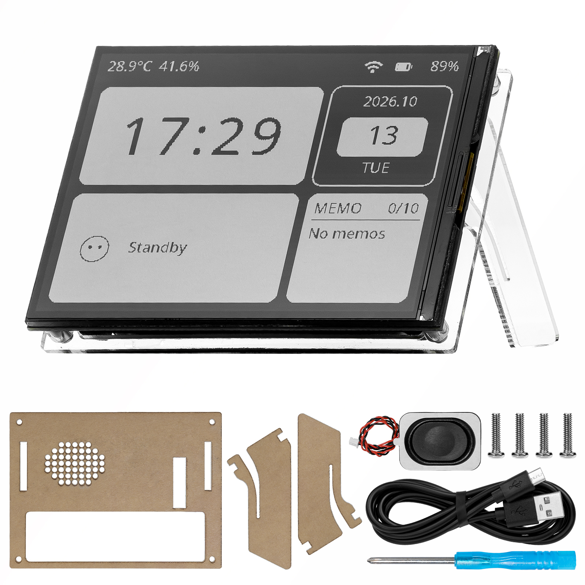
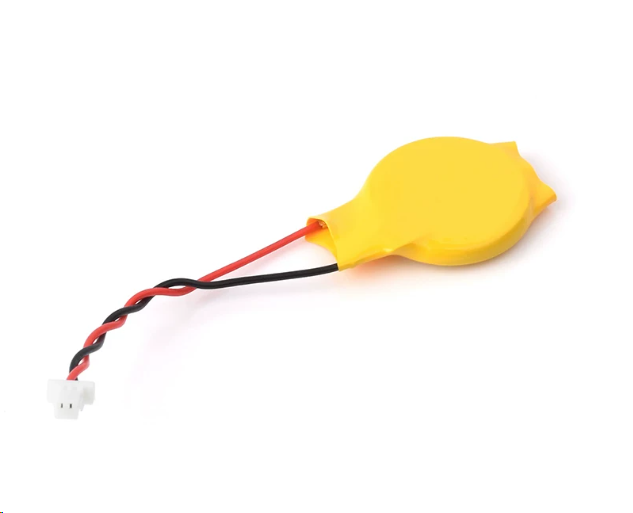

.. _about-this-kit-page:

About This Kit
==============

Product Overview
----------------

The **LAFVIN ESP32-S3 4.2inch RLCD Development Board** combines a display, audio,
temperature and humidity sensing, a real-time clock, and wireless connectivity.
It uses an ESP32-S3-WROOM-1-N16R8 module with 16 MB Flash and 8 MB PSRAM,
and features a 4.2-inch reflective LCD, 2.4 GHz Wi-Fi, and Bluetooth 5 LE.

The onboard microphones, speaker connector, temperature and humidity sensor,
real-time clock, and MicroSD card slot let you build projects such as a desktop clock,
an environmental dashboard, a voice recorder, or a wireless photo gallery.
You can also flash the supplied Xiaozhi firmware to try voice conversations,
a Pomodoro timer, and music playback.

This tutorial is intended for ESP32 beginners, electronics enthusiasts,
and anyone interested in developing desktop devices or IoT projects.
Start with individual peripherals, then combine them into your own applications.

   Development board appearance and main features.

Understanding the RLCD
----------------------

RLCD stands for reflective liquid crystal display. This board has a
**4.2-inch monochrome display** with a native resolution of **300 × 400**.
The examples in this tutorial usually use a **400 × 300** landscape layout.
The display can show the time, environmental readings, text, icons, and monochrome images.

.. note::

   This display has no backlight and relies on ambient light.
   Use it in a well-lit environment; external lighting is needed to read it in dim conditions.
   The display does not support touch input. Depending on the example,
   you interact with it using buttons, a web page, or voice commands.

Hardware Resources
------------------

The table below lists the board's main hardware and its uses.
The individual examples explain how to configure and use each peripheral.

   Rear components and connectors. The numbers match the English labels in the image.

Item 10, the ES7210, captures microphone audio. Echo cancellation requires processing algorithms in the firmware.

.. _kit-pinout:

   Onboard peripheral and expansion header pin assignments. Click the image to enlarge.

.. list-table::
   :header-rows: 1
   :widths: 22 40 38
   :class: kit-overview-table

   * - Hardware
     - Specification or Model
     - Main Use
   * - Controller module
     - ESP32-S3-WROOM-1-N16R8
     - Runs programs and controls the onboard peripherals
   * - Processor
     - Dual-core Xtensa LX7, up to 240 MHz
     - Handles display, sensor, and communication tasks
   * - Memory
     - 16 MB Flash, 8 MB PSRAM
     - Stores firmware and provides memory for graphics and data processing
   * - Display
     - 4.2-inch monochrome RLCD, ST7305 controller, 300 × 400
     - Displays text, graphics, and application interfaces
   * - Wireless connectivity
     - 2.4 GHz Wi-Fi (802.11 b/g/n), Bluetooth 5 LE
     - Connects to networks or supports Bluetooth Low Energy application development
   * - Audio input
     - Dual-microphone array, ES7210 audio ADC
     - Captures sound for recording and voice interaction
   * - Audio output
     - ES8311 audio codec, speaker connector
     - Plays audio through the supplied speaker
   * - Temperature and humidity sensor
     - SHTC3
     - Measures ambient temperature and humidity
   * - Real-time clock
     - PCF85063
     - Maintains and provides the date and time
   * - Storage interface
     - MicroSD card slot
     - Stores recordings, music, images, and other files
   * - Buttons
     - BOOT, KEY
     - Used for flashing or operating programs; behavior depends on the firmware
   * - Expansion header
     - 2 × 8-pin header exposing available GPIOs and related signals
     - Connects external sensors and other compatible modules

Kit Contents
------------

Before you begin, check the items in your kit against the list below.

.. note::

   **The kit does not include an 18650 battery, a MicroSD card, or an RTC backup battery.**
   Purchase these separately if you need the functions described below.

   Development board and supplied accessories.

.. list-table::
   :header-rows: 1
   :widths: 34 50 16
   :class: kit-overview-table

   * - Item
     - Description
     - Quantity
   * - ESP32-S3 4.2-inch RLCD development board
     - Display and onboard peripherals
     - 1
   * - Speaker
     - 8 Ω, 2 W, 1.25 mm connector
     - 1
   * - USB Type-C data cable
     - Connects the board to a computer for power and flashing
     - 1
   * - Acrylic stand
     - Supports the development board
     - 1 set
   * - Screw pack
     - For assembly and fastening
     - 1 pack
   * - Phillips screwdriver
     - For installing the screws
     - 1

.. _kit-extra-accessories:

Accessories to Purchase Separately
-----------------------------------

The following accessories are not included. Prepare them as needed for the functions you want to use.

.. list-table::
   :header-rows: 1
   :widths: 28 72
   :class: kit-overview-table

   * - Accessory
     - When You Need It
   * - 18650 battery
     - To power the board from a battery or measure battery voltage.
   * - MicroSD card
     - To read and write files, save images or recordings, or play music from a card.
   * - RTC backup battery
     - To keep the real-time clock running when the board's main power is disconnected.

Choosing and Connecting an RTC Backup Battery
~~~~~~~~~~~~~~~~~~~~~~~~~~~~~~~~~~~~~~~~~~~~~

The RTC backup battery must have a **2-pin JST PH plug**, as illustrated below.
Check both the connector type and the positive/negative wire positions when choosing a battery.

   Example RTC backup battery, sold separately.

.. warning::

   **Disconnect power and check the polarity before connecting the battery.**
   Match the battery plug's wire positions to the polarity markings on the board's RTC battery connector:
   positive (+) must connect to positive, and negative (−) to negative.
   The positive wire is usually red and the negative wire black,
   but always check the battery's documentation and markings.
   Identical-looking plugs can have opposite wire positions; a plug fitting the connector
   does not guarantee the correct polarity.

.. _kit-battery-start:

Starting the Board on Battery Power
-----------------------------------

If an **18650 main battery** is correctly installed, follow these steps to enable battery power:

#. First, plug in the USB Type-C data cable.
#. Press and hold the **PWR** button on the back of the board.
#. Release the PWR button when the **blue POWER LED** on the back lights up. Battery power is now enabled.

Refer to the hardware diagram above for the locations:
**item 15 is the PWR button, and item 17 is the POWER LED**.

Where to Start
--------------

Choose one of the three tutorial paths based on your goal.

.. list-table::
   :header-rows: 1
   :widths: 30 20 50
   :class: kit-overview-table

   * - Your Goal
     - Tutorial
     - What You Will Learn or Try
   * - Learn programming through examples
     - :ref:`arduino-tutorial`
     - Use Arduino IDE to learn about the display, networking, sensors, storage, and audio,
       then build applications such as a dashboard, voice recorder, and wireless photo gallery.
   * - Develop applications with ESP-IDF
     - :ref:`esp-idf-tutorial`
     - Use ESP-IDF projects to learn about peripheral drivers, shared components, and combined applications.
   * - Try AI voice features first
     - :ref:`xiaozhi-tutorial`
     - Flash the supplied Xiaozhi firmware, connect and bind the device, then use voice conversations,
       memos and reminders, a Pomodoro timer, and MicroSD music playback.

You can switch between tutorial paths on the same board by flashing the corresponding program or firmware.
The entry page for each section explains development tool installation, code downloads, and flashing.

References
----------

* `ESP32-S3-WROOM-1 / WROOM-1U Module Datasheet <https://www.espressif.com/sites/default/files/documentation/esp32-s3-wroom-1_wroom-1u_datasheet_en.pdf>`_
